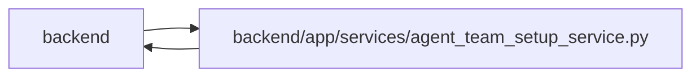

# agent_team_setup_service Module

**Path:** `backend/app/services/agent_team_setup_service.py`

## Description

Operator-only agent-team validation, reconciliation, setup, and readiness.

Role-package compatibility uses the integrity-validated catalog from `AgentSkillBundleService`, including its configured deployed artifact directory. Catalog, checksum-index, archive or trust-pin failures become the stable `agent_team_skill_catalog_unavailable` conflict; setup does not fall back to source-tree metadata.

Runtime acknowledgement remains scoped to its exact issued handoff credential. Readiness compares every current handoff revision, and a stale acknowledgement blocks dispatch. An explicit refresh requires the prior receipt digest plus current package, profile, bindings, topology, features and modes; normal duplicate replay retains its existing semantics. Managed controllers receive workspace membership explicitly, and account disablement remains separate from runtime readiness and model-binding observations.

Stored contracts are read with the stored-contract loaders, so a team stored under earlier role rules stays readable. Status and acknowledgement judge a member by the same contract, its member row: an outdated member carries `stored_contract_outdated`, gets no handoff, is refused acknowledgement with `agent_team_ack_contract_outdated`, and stays out of dispatch while the rest of the team works. The plan replaces the contract with an ordinary update, and credential recovery on an outdated contract may also take the role-governed fields of the current master.

## Imports

| Source | Symbols |
|--------|---------|
| `__future__` | `annotations` |
| `app.agent_contract` | `AGENT_CONTRACT_FEATURES`, `AGENT_TEAM_MASTER_FEATURE`, `MODEL_AWARE_ROUTING_FEATURE` |
| `app.authority` | `internal_authority` |
| `app.commands` | `commit_or_flush` |
| `app.config` | `get_settings` |
| `app.models.agent` | `AgentActor`, `AgentModelBinding`, `AgentModelCatalogEntry`, `AgentRun`, `AgentTeamActionReceipt`, `AgentTeamApplyRun`, `AgentTeamManagedObject`, `AgentTeamTopology`, `AgentTeamTopologyMember`, `AgentTaskAssignment`, `TaskEvent` |
| `app.models.identity` | `Principal` |
| `app.models.team_member` | `TeamMemberProfile` |
| `app.schemas.agent_planning` | `AgentPlanningCommandContext` |
| `app.schemas.agent_skill_bundle` | `SkillBundleCatalogResponse` |
| `app.schemas.agent_team_setup` | `AGENT_TEAM_PLAN_SCHEMA_VERSION`, `AGENT_TEAM_ROLE_RULE_FIELDS`, `MAX_AGENT_TEAM_ACTIONS`, `ROLE_SCOPE_PRESETS`, `AgentTeamActionReceipt`, `AgentTeamActionStatus`, `AgentTeamApplyRequest`, `AgentTeamApplyResponse`, `AgentTeamCurrentMember`, `AgentTeamCurrentSnapshot`, `AgentTeamManifestRequest`, `AgentTeamMaster`, `AgentTeamMemberLifecycle`, `AgentTeamMemberSpec`, `AgentTeamMemberStatus`, `AgentTeamPlanAction`, `AgentTeamPlanRequest`, `AgentTeamReconciliationClass`, `AgentTeamReconciliationPlan`, `AgentTeamRuntimeAcknowledgement`, `AgentTeamRuntimeAcknowledgementResponse`, `AgentTeamRuntimeHandoff`, `AgentTeamDispatchAvailability`, `AgentTeamSetupReport`, `AgentTeamSetupReportCounts`, `AgentTeamSetupReportEvidence`, `AgentTeamSetupStep`, `AgentTeamSkillPackage`, `AgentTeamStatusResponse`, `AgentTeamValidateResponse`, `ensure_agent_team_secret_free`, `load_stored_agent_team_master`, `load_stored_agent_team_member`, `parse_agent_team_master`, `reconcile_agent_team_master` |
| `app.services.agent_profile_catalog_service` | `ALL_PROFILE_PRESETS`, `AgentProfileCatalogService` |
| `app.services.agent_routing_rollout` | `AgentRoutingTopologyReadiness` |
| `app.services.agent_service` | `AgentConflictError`, `AgentPermissionError`, `AgentService`, `actor_scopes`, `hash_api_key`, `require_scope`, `validate_idempotency_key` |
| `app.services.agent_skill_bundle_service` | `AgentSkillBundleService`, `SkillBundleArtifactError` |
| `app.services.agent_team_credentials` | `CredentialDeliveryError`, `AgentTeamCredentialSink`, `FilesystemAgentTeamCredentialSink` |
| `app.services.identity_service` | `bind_verified_system` |
| `app.utils.time` | `as_utc`, `utc_now` |
| `dataclasses` | `dataclass` |
| `datetime` | `timedelta` |
| `hashlib` | `hashlib` |
| `json` | `json` |
| `secrets` | `secrets` |
| `sqlalchemy` | `func`, `or_`, `select`, `text` |
| `sqlalchemy.exc` | `IntegrityError` |
| `sqlalchemy.ext.asyncio` | `AsyncSession` |
| `sqlalchemy.orm` | `selectinload` |
| `typing` | `Any` |

## Local dependency map

<!-- Auto-generated local dependency summary. Do not edit by hand. -->

> Module-level dependencies exceed the generated-diagram limits, so the diagram and table below group them by top-level package. Counts report the number of module neighbors in each package.

### Internal neighbors

| Direction | Module |
|---|---|
| Inbound | `backend` (9) |
| Outbound | `backend` (17) |

### External packages

| Language | Used packages | Undeclared packages |
|---|---:|---:|
| python | 1 | 0 |

> All 26 module neighbor(s) are summarized by package because the module-level view exceeds the 12-node limit.

## Classes

| Class | Line | Bases | Description |
|-------|------|-------|-------------|
| [AgentTeamSetupConflictError](../entities/AgentTeamSetupConflictError.md) | 105 | `AgentConflictError` | Stable conflict envelope shared by setup REST and MCP reads. |
| [AgentTeamMembershipBoundary](../entities/AgentTeamMembershipBoundary.md) | 119 | — | Current topology/revision and active member set for exact-actor routing. |
| [AgentTeamSetupService](../entities/AgentTeamSetupService.md) | 174 | — | Reconcile one portable topology without making the UI a control plane. |

## Functions

| Function | Signature | Decorators | Description |
|----------|-----------|------------|-------------|
| `_json_loads` | `(value: str \| None, fallback: Any) -> Any` | — | — |
| `_canonical_json` | `(value: Any) -> str` | — | — |
| `_digest` | `(value: Any) -> str` | — | — |
| `_member_contract_outdated` | `(record: AgentTeamTopologyMember \| None, desired: AgentTeamMemberSpec) -> bool` | — | Say whether a member's stored contract breaks today's role rules. |