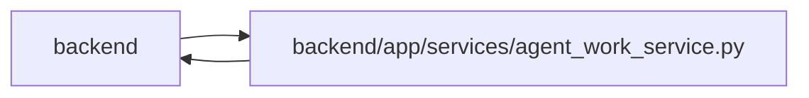

# agent_work_service Module

**Path:** `backend/app/services/agent_work_service.py`

## Description

Durable agent assignment, current-work, verification, and recovery services.

People read assignments through a separate projection scoped like tasks; it names the actor and declared model and leaves routing evidence and the assigner's reason with agent-key reads.

Assigned work retains exact actor, assignment, claim generation, model and task-context fences. Public mutation methods own an atomic transaction when called standalone and join their transport owner otherwise. Structured criterion evidence is saved inside the same submission as resolution. Independent rejection records its verdict, invalidates current progress and hands back fresh work without changing the historical executor.

Assigned definition and start decisions use complete inherited deferral policy. Live renewal, successful submission and fence replay recheck execution eligibility; ancestor edits invalidate descendant task context even when a legacy structural parent's summary flag is stale. Old worker fences cannot authorize changed scope, while existing failure, recovery and independent rework paths remain distinct.

Assigned normal execution compares scheduled starts with the project working date at the captured UTC instant, using the same date helper as human lifecycle and schedule signals. Future starts remain blocked across local midnight and DST boundaries. Inherited deferral, exact assignment lineage, dependency readiness, claims and structured verification fences remain mandatory.

A calculated start date in the future does not hold assigned work back. Work may begin once its dependencies are done; only a planning period that has not begun and a real earliest-start date hold it. After an atomic begin or submit, the planned work of the iteration is recalculated around the actual dates inside the same command.

A team controller can advance another actor’s queue only for the revision and scope authorized by the current dispatch or recovery command. Recovery checks the selected worker and every owner whose assignment, run or claim would change. A successful retry returns the original assignment receipt without consuming another planning revision.

When independent review returns work to its original submitter, the assigned-work queue shows the effective reviewer profile and worker binding. The worker starts that exact assignment with its current queue revision and observed model. The new run records the handback while the original assignment, submission and verdict retain their recorded contents.

A worker can continue across a verified planning-only reservation using its current task version and original live claim. It still needs its own current assignment, model and team authority. After expiry, ordinary PM recovery creates a new assignment and claim generation.

A change to a queued verification's reviewer or binding requires fresh evidence for that selection. The PM can cancel or reorder the queue after a receipt expires or is revoked. Both acceptance and rejection require a currently valid receipt when the assignment uses one.

## Imports

| Source | Symbols |
|--------|---------|
| `__future__` | `annotations` |
| `app.authority` | `internal_authority`, `internal_authority` |
| `app.commands` | `atomic_command`, `commit_or_flush`, `current_command` |
| `app.models.agent` | `AgentActor`, `AgentIdempotencyRecord`, `AgentModelBinding`, `AgentRun`, `AgentTaskAssignment`, `TaskEvent` |
| `app.models.iteration` | `Iteration` |
| `app.models.project` | `Project`, `ProjectUpdateEntry` |
| `app.models.task` | `Task`, `TaskDependency`, `TaskStatus` |
| `app.models.team_member` | `TeamMember`, `TeamMemberProfile` |
| `app.models.triage` | `TriageItem` |
| `app.query_limits` | `CollectionLimitExceededError`, `MAX_BOUNDED_LIST_ITEMS` |
| `app.schemas.agent` | `declared_harness`, `AgentActorResponse`, `AgentActorRosterProfile`, `AgentActorRosterProfileSkill`, `AgentDiscoveryTriageCreate`, `AgentDiscoveryTriageResponse`, `AgentProjectUpdateCreate`, `AgentProjectUpdateResponse`, `AgentActorRosterItem`, `AgentCollectionPageMetadata`, `AgentDependencyContext`, `AgentPaginationMetadata`, `AgentRecoveryListResponse`, `AgentReviewVerdict`, `AgentReviewVerdictResponse`, `AgentReviewQueueResponse`, `AgentRecoveryItem`, `AgentRecoveryRequeue`, `AgentRecoveryRequeueResponse`, `AgentAssignmentActorSummary`, `AgentAssignmentModelSummary`, `AgentAssignmentReadItem`, `AgentRunResponse`, `AgentTaskAssignmentCreate`, `AgentTaskAssignmentResponse`, `AgentTaskAssignmentUpdate`, `AgentTaskContextResponse`, `AgentWorkBegin`, `AgentWorkBeginResponse`, `AgentWorkDecisionResponse`, `AgentWorkItem`, `AgentWorkPaginationMetadata`, `AgentWorkRenew`, `AgentWorkSubmit`, `AgentWorkTerminal`, `AgentWorkTerminalResponse`, `ModelAwareAgentTaskAssignmentCreate`, `ModelAwareAgentTaskAssignmentUpdate`, `ModelAwareAgentWorkBegin` |
| `app.schemas.agent_planning` | `AgentPlanningCommandContext` |
| `app.schemas.project` | `ProjectUpdateEntryCreate` |
| `app.schemas.task_brief` | `ProgressWrite` |
| `app.schemas.triage` | `TriageItemCreate` |
| `app.services.agent_model_catalog_service` | `AgentModelCatalogService` |
| `app.services.agent_routing_observability` | `RoutingOperationalEvent`, `opaque_value_digest`, `record_routing_operational_event` |
| `app.services.agent_routing_policy` | `MODEL_FAILURE_CATEGORIES`, `ROUTING_DECISION_AUTHORITY`, `ROUTING_DECISION_LINEAGE_FIELDS`, `ROUTING_LINEAGE_AUTHORITY`, `ROUTING_POLICY_VERSION`, `canonical_routing_json_bytes`, `evaluate_actor_authorization`, `normalize_model_failure_category`, `validate_routing_packet_size` |
| `app.services.agent_routing_rollout` | `AgentRoutingRolloutError`, `AgentRoutingRolloutMode`, `AgentRoutingRolloutService`, `AgentRoutingTopologyReadinessStatus` |
| `app.services.agent_routing_service` | `AgentRoutingConflictError`, `AgentRoutingConflictError`, `AgentRoutingConflictError`, `AgentRoutingService`, `AgentRoutingService`, `AgentRoutingConflictError`, `AgentRoutingConflictError`, `AgentRoutingConflictError`, `AgentRoutingConflictError`, `AgentRoutingConflictError` |
| `app.services.agent_service` | `AgentConflictError`, `AgentPermissionError`, `actor_has_scope`, `actor_scopes`, `validate_idempotency_key`, `AgentService` |
| `app.services.agent_team_setup_service` | `AgentTeamMembershipBoundary`, `AgentTeamSetupService`, `AgentTeamSetupService`, `AgentTeamSetupConflictError`, `AgentTeamSetupService` |
| `app.services.delivery_dependency_service` | `DeliveryDependencyService` |
| `app.services.execution_planning_window` | `assignment_matches`, `require_window_authority`, `window_authority_matches` |
| `app.services.external_link_service` | `ExternalLinkService` |
| `app.services.project_service` | `ProjectService` |
| `app.services.retained_planning_output` | `REQUIRED`, `REQUIRED`, `recovery_attestation_hint`, `REQUIRED`, `recovery_attestation_hint` |
| `app.services.review_evidence` | `check_supervised_selection`, `check_supervised_selection` |
| `app.services.review_provenance` | `ReworkReadCache`, `actor_provenance`, `different_publisher_required`, `rework_binding_identity`, `select_reviewer`, `supervised_rework_evidence`, `record_terminal_observation`, `record_terminal_observation`, `observe_review_candidate`, `verify_verdict`, `mark_server_interruption` |
| `app.services.scheduler_service` | `SchedulerService` |
| `app.services.task_brief_service` | `TaskBriefService`, `TaskBriefService`, `brief_definition_blockers`, `brief_definition_blockers` |
| `app.services.task_service` | `TaskService`, `TaskVersionConflictError` |
| `app.services.triage_service` | `TriageService` |
| `app.services.work_metrics` | `effective_work_flags`, `working_today`, `effective_work_flags`, `effective_work_flags`, `effective_work_flags` |
| `app.utils.github_links` | `GitHubLinkError`, `parse_github_url` |
| `app.utils.time` | `as_utc`, `utc_now` |
| `base64` | `base64` |
| `binascii` | `binascii` |
| `datetime` | `date`, `datetime`, `timedelta` |
| `hashlib` | `hashlib` |
| `json` | `json` |
| `logging` | `logging` |
| `secrets` | `secrets` |
| `sqlalchemy` | `func`, `or_`, `select`, `text` |
| `sqlalchemy.ext.asyncio` | `AsyncSession` |
| `sqlalchemy.orm` | `selectinload` |
| `typing` | `TYPE_CHECKING`, `Any`, `Callable`, `Iterable`, `Optional` |

## Local dependency map

<!-- Auto-generated local dependency summary. Do not edit by hand. -->

> Module-level dependencies exceed the generated-diagram limits, so the diagram and table below group them by top-level package. Counts report the number of module neighbors in each package.

### Internal neighbors

| Direction | Module |
|---|---|
| Inbound | `backend` (26) |
| Outbound | `backend` (35) |

### External packages

| Language | Used packages | Undeclared packages |
|---|---:|---:|
| python | 1 | 0 |

> All 58 module neighbor(s) are summarized by package because the module-level view exceeds the 12-node limit.

## Classes

| Class | Line | Bases | Description |
|-------|------|-------|-------------|
| [AgentWorkService](../entities/AgentWorkService.md) | 185 | — | Coordinate PM dispatch and low-freedom worker lifecycle commands. |

## Functions

| Function | Signature | Decorators | Description |
|----------|-----------|------------|-------------|
| `_json_loads` | `(value: Optional[str], fallback: Any) -> Any` | — | — |
| `parse_task_brief` | `(description: Optional[str]) -> dict[str, str]` | — | Parse level-two Markdown sections from the portable task-brief template. |
