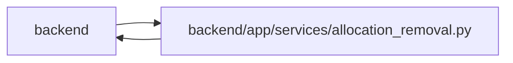

# allocation_removal Module

**Path:** `backend/app/services/allocation_removal.py`

## Description

Check whether removing a capacity allocation changes planning alone.

The standalone removal command classifies retained task and routing records before reserving the planning writer. Under the reservation it rechecks foreign keys, issued work and open task ownership. A proven unused row preserves task versions. A guarded command refuses a stale or unclassified observation, and an ordinary command retains its existing conservative deletion behavior.

## Imports

| Source | Symbols |
|--------|---------|
| `app.authority` | `internal_authority` |
| `app.commands` | `PlanningConflict`, `current_command` |
| `app.database` | `Base` |
| `app.models.agent` | `AgentActor`, `AgentRun`, `AgentTaskAssignment` |
| `app.models.capacity` | `PlanningState` |
| `app.models.task` | `Task` |
| `app.models.team_member` | `TeamMember` |
| `app.schemas.agent_routing` | `RoutingDecisionSnapshot` |
| `app.services.agent_routing_policy` | `MAX_ROUTING_SNAPSHOT_BYTES`, `ROUTING_DECISION_AUTHORITY`, `ROUTING_DECISION_LINEAGE_FIELDS`, `ROUTING_LINEAGE_AUTHORITY`, `ROUTING_POLICY_VERSION` |
| `app.services.execution_planning_window` | `LIVE_ASSIGNMENT_STATES`, `LIVE_RUN_STATE` |
| `dataclasses` | `dataclass` |
| `functools` | `lru_cache` |
| `json` | `json` |
| `pydantic` | `TypeAdapter` |
| `sqlalchemy` | `String`, `cast`, `inspect`, `or_`, `select`, `text` |

## Local dependency map

<!-- Auto-generated local dependency summary. Do not edit by hand. -->

> Module-level dependencies exceed the generated-diagram limits, so the diagram and table below group them by top-level package. Counts report the number of module neighbors in each package.

### Internal neighbors

| Direction | Module |
|---|---|
| Inbound | `backend` (3) |
| Outbound | `backend` (10) |

### External packages

| Language | Used packages | Undeclared packages |
|---|---:|---:|
| python | 2 | 0 |

> All 12 module neighbor(s) are summarized by package because the module-level view exceeds the 12-node limit.

## Classes

| Class | Line | Bases | Description |
|-------|------|-------|-------------|
| [AllocationHistory](../entities/AllocationHistory.md) | 237 | — | — |

## Functions

| Function | Signature | Decorators | Description |
|----------|-----------|------------|-------------|
| `foreign_keys_to_members` | `(connection)` | — | Return the physical allocation references, including extensions absent from the ORM. |
| `_history_statement` | `(dialect)` | — | — |
| `_historical_task_reference` | *(async)* `(db, member_id)` | — | — |
| `_decision_field` | `(name)` | `@lru_cache(maxsize=64)` | — |
| `_positive_ids` | `(values)` | — | — |
| `_lineage_ids` | `(value)` | — | Classify the current pending and completed lineage formats and their compact prior decisions. |
| `_routing_ids` | `(raw)` | `@lru_cache(maxsize=256)` | Cache verified owners by the exact bounded source bytes; None denotes unclassified history. |
| `_mapped_references` | `()` | — | — |
| `mapped_allocation_references` | `(db)` | — | — |
| `_direct_reference` | *(async)* `(db, member_id)` | — | — |
| `inspect_allocation_history` | *(async)* `(db, member_id)` | — | Read history before the planning writer is reserved; return only its revision and a boolean. |
| `is_unused_allocation` | *(async)* `(db, member_id, history, *, unused_only)` | — | Called after authorization and the global planning and affected iteration locks. |
