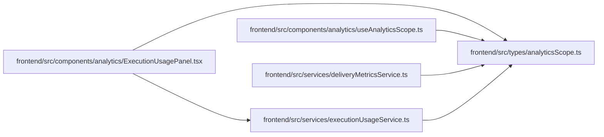

# analyticsScope Module

**Path:** `frontend/src/types/analyticsScope.ts`

## Description

_Auto-generated from `frontend/src/types/analyticsScope.ts`._

## Module Signals

| Signal | Values |
|--------|--------|
| Exports | `AnalyticsScope` |

## Local dependency map

<!-- Auto-generated local dependency summary. Do not edit by hand. -->
This graph shows full source coupling. Type dependencies can be erased; compiler-dependent cycle groups are runtime candidates, not confirmed initialization cycles.

### Internal neighbors

| Direction | Module |
|---|---|
| Inbound | [ExecutionUsagePanel](../modules/ExecutionUsagePanel.md) |
| Inbound | [useAnalyticsScope](../modules/useAnalyticsScope.md) |
| Inbound | [deliveryMetricsService](../modules/deliveryMetricsService.md) |
| Inbound | [executionUsageService](../modules/executionUsageService.md) |

## Classes

| Class | Kind | Line | Bases / Target | Description |
|-------|------|------|----------------|-------------|
| [AnalyticsScope](../entities/AnalyticsScope.md) | Interface | 1 | — | — |
