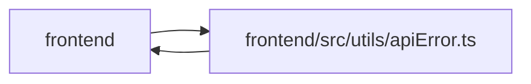

# apiError Module

**Path:** `frontend/src/utils/apiError.ts`

## Description

_Auto-generated from `frontend/src/utils/apiError.ts`._

## Imports

| Source | Symbols | Type-only | Runtime emission |
|--------|---------|-----------|------------------|
| `../types/task` | `RefusalNextStep` | Declaration | erased |

## Module Signals

| Signal | Values |
|--------|--------|
| Exports | `ApiErrorKind`, `ApiFieldError`, `NormalizedApiError`, `getApiErrorMessage`, `getApiErrorStatus`, `getApiFieldErrors`, `getApiNextStep`, `normalizeApiError` |

## Local dependency map

<!-- Auto-generated local dependency summary. Do not edit by hand. -->
This graph shows full source coupling. Type dependencies can be erased; compiler-dependent cycle groups are runtime candidates, not confirmed initialization cycles.

> Module-level dependencies exceed the generated-diagram limits, so the diagram and table below group them by top-level package. Counts report the number of module neighbors in each package.

### Internal neighbors

| Direction | Module |
|---|---|
| Inbound | `frontend` (74) |
| Outbound | `frontend` (1) |

> All 75 module neighbor(s) are summarized by package because the module-level view exceeds the 12-node limit.

## Classes

| Class | Kind | Line | Bases / Target | Description |
|-------|------|------|----------------|-------------|
| [ApiFieldError](../entities/ApiFieldError.md) | Interface | 5 | — | — |
| [NormalizedApiError](../entities/NormalizedApiError.md) | Interface | 10 | — | — |
| [ApiErrorShape](../entities/ApiErrorShape.md) | Interface | 19 | — | — |
| [ApiErrorKind](../entities/ApiErrorKind.md) | Type alias | 3 | `'response' \| 'network' \| 'unknown'` | — |
| [UnknownRecord](../entities/UnknownRecord.md) | Type alias | 28 | `Record<string, unknown>` | — |

## Functions

| Function | Signature | Decorators | Description |
|----------|-----------|------------|-------------|
| `normalizeApiError` | `(error: unknown, fallback: string) -> NormalizedApiError` | — | — |
| `getApiErrorMessage` | `(error: unknown, fallback: string)` | — | — |
| `getApiNextStep` | `(error: unknown) -> RefusalNextStep \| null` | — | The next step a refusal names, from its structured envelope; null when it names none. |
| `getApiErrorStatus` | `(error: unknown)` | — | — |
| `getApiFieldErrors` | `(error: unknown, fallback: string)` | — | — |
