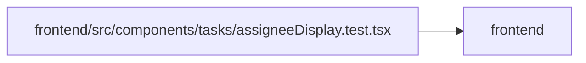

# assigneeDisplay.test Module

**Path:** `frontend/src/components/tasks/assigneeDisplay.test.tsx`

## Description

_Auto-generated from `frontend/src/components/tasks/assigneeDisplay.test.tsx`._

## Imports

| Source | Symbols | Type-only | Runtime emission |
|--------|---------|-----------|------------------|
| `../../test/renderWithProviders` | `renderWithProviders` | — | compiler-dependent |
| `../../types/agent` | `AgentPipeline` | Declaration | erased |
| `../../types/gantt` | `GanttTask` | Declaration | erased |
| `../../types/task` | `Task` | Declaration | erased |
| `../../utils/taskFilterDefaults` | `defaultFilters` | — | compiler-dependent |
| `../gantt/GanttChart` | `GanttChart` | — | compiler-dependent |
| `./KanbanBoard/KanbanCard` | `KanbanCard` | — | compiler-dependent |
| `./PipelineView` | `PipelineView` | — | compiler-dependent |
| `./TaskReadView` | `TaskReadView` | — | compiler-dependent |
| `./TaskRow` | `TaskRow` | — | compiler-dependent |
| `./useAgentRowFacts` | `agentRowValues`, `useAgentRowFacts` | — | compiler-dependent |
| `./usePipeline` | `usePipeline` | Declaration | erased |
| `@testing-library/react` | `screen`, `waitFor`, `within` | — | compiler-dependent |
| `vitest` | `beforeEach`, `describe`, `expect`, `it`, `vi` | — | compiler-dependent |

## Module Signals

| Signal | Values |
|--------|--------|
| Constants | `services`, `base`, `options`, `listOptions` |
| Module calls | `services = hoisted`, `mock`, `mock`, `mock`, `mock`, `mock`, `mock`, `mock`, `mock`, `mock`, `mock`, `beforeEach`, `describe` |

## Local dependency map

<!-- Auto-generated local dependency summary. Do not edit by hand. -->
This graph shows full source coupling. Type dependencies can be erased; compiler-dependent cycle groups are runtime candidates, not confirmed initialization cycles.

> Module-level dependencies exceed the generated-diagram limits, so the diagram and table below group them by top-level package. Counts report the number of module neighbors in each package.

### Internal neighbors

| Direction | Module |
|---|---|
| Outbound | `frontend` (12) |

### External packages

| Language | Used packages | Undeclared packages |
|---|---:|---:|
| typescript | 2 | 0 |

> All 12 module neighbor(s) are summarized by package because the module-level view exceeds the 12-node limit.
