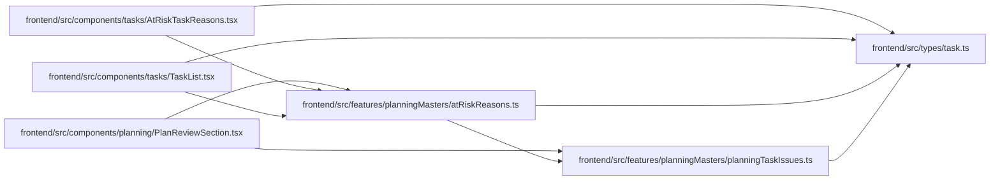

# atRiskReasons Module

**Path:** `frontend/src/features/planningMasters/atRiskReasons.ts`

## Description

_Auto-generated from `frontend/src/features/planningMasters/atRiskReasons.ts`._

## Imports

| Source | Symbols | Type-only | Runtime emission |
|--------|---------|-----------|------------------|
| `../../types/task` | `Task` | Declaration | erased |
| `./planningTaskIssues` | `isOutsideDateLimits` | — | compiler-dependent |

## Module Signals

| Signal | Values |
|--------|--------|
| Exports | `atRiskReasons` |

## Local dependency map

<!-- Auto-generated local dependency summary. Do not edit by hand. -->
This graph shows full source coupling. Type dependencies can be erased; compiler-dependent cycle groups are runtime candidates, not confirmed initialization cycles.

### Internal neighbors

| Direction | Module |
|---|---|
| Inbound | [PlanReviewSection](../modules/PlanReviewSection.md) |
| Inbound | [AtRiskTaskReasons](../modules/AtRiskTaskReasons.md) |
| Inbound | [TaskList](../modules/TaskList.md) |
| Outbound | [planningTaskIssues](../modules/planningTaskIssues.md) |
| Outbound | [types_task](../modules/types_task.md) |

## Classes

| Class | Kind | Line | Bases / Target | Description |
|-------|------|------|----------------|-------------|
| [Translate](../entities/atRiskReasons_Translate.md) | Type alias | 4 | `(key: string) => string` | — |
| [RiskFields](../entities/RiskFields.md) | Type alias | 6 | <pre><code>Pick&#60;Task&#44; &#39;is&#95;overdue&#39; &#124; &#39;is&#95;delayed&#39; &#124; &#39;is&#95;outside&#95;constraints&#39;&#62;&#10;    &#38; Partial&#60;Pick&#60;Task&#44; &#39;start&#95;date&#39; &#124; &#39;end&#95;date&#39; &#124; &#39;min&#95;start&#95;date&#39; &#124; &#39;max&#95;end&#95;date&#39; &#124; &#39;actual&#95;start&#95;date&#39; &#124; &#39;baseline&#95;start&#95;date&#39;&#62;&#62;</code></pre> | — |

## Functions

| Function | Signature | Decorators | Description |
|----------|-----------|------------|-------------|
| `atRiskReasons` | `(task: RiskFields, t: Translate) -> string[]` | — | Why a task counts as an at-risk signal, in the words Plan and the Tasks list share. |
