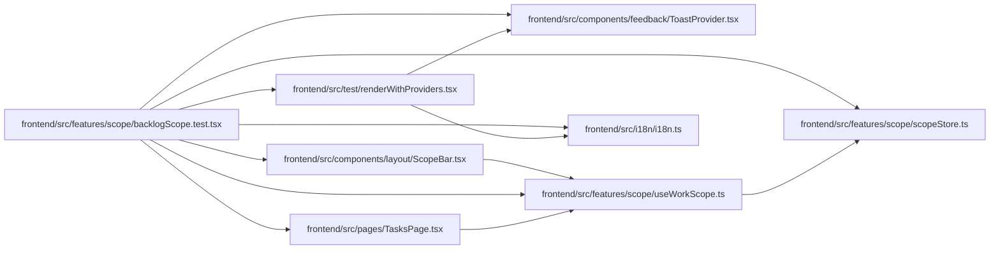

# backlogScope.test Module

**Path:** `frontend/src/features/scope/backlogScope.test.tsx`

## Description

_Auto-generated from `frontend/src/features/scope/backlogScope.test.tsx`._

## Imports

| Source | Symbols | Type-only | Runtime emission |
|--------|---------|-----------|------------------|
| `../../components/feedback/ToastProvider` | `ToastProvider` | — | compiler-dependent |
| `../../components/layout/ScopeBar` | `ScopeBar` | — | compiler-dependent |
| `../../i18n/i18n` | `i18n` | — | compiler-dependent |
| `../../pages/TasksPage` | `TasksPage` | — | compiler-dependent |
| `../../test/renderWithProviders` | `createTestQueryClient` | — | compiler-dependent |
| `./scopeStore` | `useScopeStore` | — | compiler-dependent |
| `./useWorkScope` | `useWorkScope` | — | compiler-dependent |
| `@tanstack/react-query` | `QueryClientProvider` | — | compiler-dependent |
| `@testing-library/react` | `act`, `render`, `screen`, `waitFor` | — | compiler-dependent |
| `@testing-library/user-event` | `userEvent` | — | compiler-dependent |
| `react-router-dom` | `createMemoryRouter`, `Outlet`, `RouterProvider`, `useLocation` | — | compiler-dependent |
| `vitest` | `afterEach`, `beforeEach`, `describe`, `expect`, `it`, `vi` | — | compiler-dependent |

## Module Signals

| Signal | Values |
|--------|--------|
| Constants | `iterationServiceMock`, `projectServiceMock`, `taskServiceMock`, `savedViewServiceMock`, `ITERATIONS`, `PROJECTS` |
| Module calls | `iterationServiceMock = hoisted`, `projectServiceMock = hoisted`, `taskServiceMock = hoisted`, `savedViewServiceMock = hoisted`, `mock`, `mock`, `mock`, `mock`, `mock`, `mock`, `mock`, `mock`, `mock`, `mock`, `describe`, `describe` |

## Local dependency map

<!-- Auto-generated local dependency summary. Do not edit by hand. -->

### Internal neighbors

| Direction | Module |
|---|---|
| Outbound | [ToastProvider](../modules/ToastProvider.md) |
| Outbound | [ScopeBar](../modules/ScopeBar.md) |
| Outbound | [scopeStore](../modules/scopeStore.md) |
| Outbound | [useWorkScope](../modules/useWorkScope.md) |
| Outbound | [i18n](../modules/i18n.md) |
| Outbound | [TasksPage](../modules/TasksPage.md) |
| Outbound | [renderWithProviders](../modules/renderWithProviders.md) |

### External packages

| Language | Used packages | Undeclared packages |
|---|---:|---:|
| typescript | 5 | 0 |
