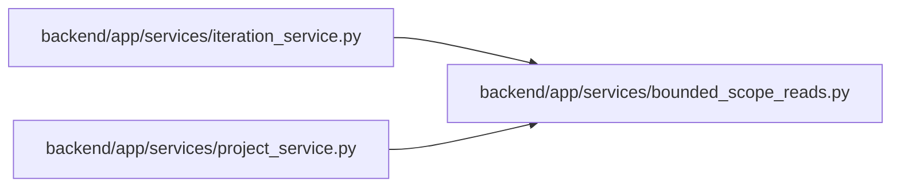

# bounded_scope_reads Module

**Path:** `backend/app/services/bounded_scope_reads.py`

## Description

The shared ID-window helper applies bounds and carried insertion ceilings to the caller’s authorized metadata query. It does not bypass ORM scope, mutate records or grant repair privileges. Project/iteration facades retain their published request and response contracts.

Shared finite ID-window reads; the caller supplies its authorized projection.

## Imports

| Source | Symbols |
|--------|---------|
| `sqlalchemy` | `select` |

## Local dependency map

<!-- Auto-generated local dependency summary. Do not edit by hand. -->

### Internal neighbors

| Direction | Module |
|---|---|
| Inbound | [iteration_service](../modules/iteration_service.md) |
| Inbound | [project_service](../modules/project_service.md) |

### External packages

| Language | Used packages | Undeclared packages |
|---|---:|---:|
| python | 1 | 0 |

## Functions

| Function | Signature | Decorators | Description |
|----------|-----------|------------|-------------|
| `scope_page` | *(async)* `(db, model, query, *, limit = 100, after_id = 0, upper_id = None)` | — | — |