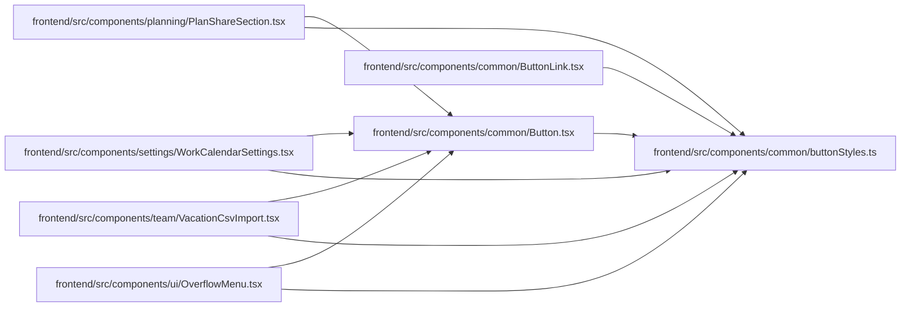

# buttonStyles Module

**Path:** `frontend/src/components/common/buttonStyles.ts`

## Description

_Auto-generated from `frontend/src/components/common/buttonStyles.ts`._

## Imports

| Source | Symbols | Type-only | Runtime emission |
|--------|---------|-----------|------------------|
| `clsx` | `clsx` | — | compiler-dependent |

## Module Signals

| Signal | Values |
|--------|--------|
| Exports | `ButtonSize`, `ButtonVariant`, `buttonClassName` |

## Local dependency map

<!-- Auto-generated local dependency summary. Do not edit by hand. -->
This graph shows full source coupling. Type dependencies can be erased; compiler-dependent cycle groups are runtime candidates, not confirmed initialization cycles.

### Internal neighbors

| Direction | Module |
|---|---|
| Inbound | [Button](../modules/Button.md) |
| Inbound | [ButtonLink](../modules/ButtonLink.md) |
| Inbound | [PlanShareSection](../modules/PlanShareSection.md) |
| Inbound | [WorkCalendarSettings](../modules/WorkCalendarSettings.md) |
| Inbound | [VacationCsvImport](../modules/VacationCsvImport.md) |
| Inbound | [OverflowMenu](../modules/OverflowMenu.md) |

### External packages

| Language | Used packages | Undeclared packages |
|---|---:|---:|
| typescript | 1 | 0 |

## Classes

| Class | Kind | Line | Bases / Target | Description |
|-------|------|------|----------------|-------------|
| [ButtonVariant](../entities/ButtonVariant.md) | Type alias | 3 | `'primary' \| 'secondary' \| 'danger' \| 'warning' \| 'ghost' \| 'outline' \| 'plain'` | — |
| [ButtonSize](../entities/ButtonSize.md) | Type alias | 4 | `'sm' \| 'md' \| 'lg'` | — |

## Functions

| Function | Signature | Decorators | Description |
|----------|-----------|------------|-------------|
| `buttonClassName` | `(variant: ButtonVariant = 'primary', size: ButtonSize = 'md', className?: string, iconOnly = false)` | — | — |
