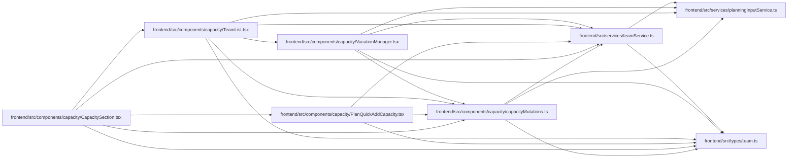

# capacityMutations Module

**Path:** `frontend/src/components/capacity/capacityMutations.ts`

## Description

_Auto-generated from `frontend/src/components/capacity/capacityMutations.ts`._

## Imports

| Source | Symbols | Type-only | Runtime emission |
|--------|---------|-----------|------------------|
| `../../services/planningInputService` | `planningInputService` | — | compiler-dependent |
| `../../services/teamService` | `teamService` | — | compiler-dependent |
| `../../types/team` | `TeamMember`, `TeamMemberCreate` | Declaration | erased |
| `@tanstack/react-query` | `QueryClient` | Declaration | erased |

## Module Signals

| Signal | Values |
|--------|--------|
| Exports | `addCapacityRows`, `refreshCapacity` |

## Local dependency map

<!-- Auto-generated local dependency summary. Do not edit by hand. -->
This graph shows full source coupling. Type dependencies can be erased; compiler-dependent cycle groups are runtime candidates, not confirmed initialization cycles.

### Internal neighbors

| Direction | Module |
|---|---|
| Inbound | [CapacitySection](../modules/CapacitySection.md) |
| Inbound | [PlanQuickAddCapacity](../modules/PlanQuickAddCapacity.md) |
| Inbound | [TeamList](../modules/TeamList.md) |
| Inbound | [VacationManager](../modules/VacationManager.md) |
| Outbound | [planningInputService](../modules/planningInputService.md) |
| Outbound | [teamService](../modules/teamService.md) |
| Outbound | [types_team](../modules/types_team.md) |

### External packages

| Language | Used packages | Undeclared packages |
|---|---:|---:|
| typescript | 1 | 0 |

## Functions

| Function | Signature | Decorators | Description |
|----------|-----------|------------|-------------|
| `refreshCapacity` | `(client: QueryClient)` | — | — |
| `addCapacityRows` | *(async)* `(iterationId: number, candidates: TeamMemberCreate[])` | — | Read revisions separately for each write, since creating a row changes the iteration. |
