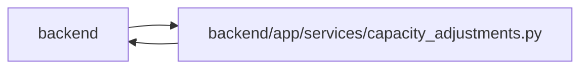

# capacity_adjustments Module

**Path:** `backend/app/services/capacity_adjustments.py`

## Description

Dated availability adjustments on iteration capacity rows.

A capacity row (``TeamMember``) has one availability percentage for its whole
iteration. An adjustment replaces that percentage on a bounded date range only.
Every capacity calculation reads the effective percentage through
``DatedAvailability``, so a date without an adjustment keeps the row's own value.

Changing an adjustment is a shared planning input change: it advances the shared
planning revision and the revision of every iteration whose capacity it can
affect. It changes no task, so task versions and issued work stay current. A
reduction on dates where this row's issued work is scheduled is refused.

## Imports

| Source | Symbols |
|--------|---------|
| `app.authority` | `internal_authority` |
| `app.commands` | `PlanningConflict`, `current_command`, `planning_input_reservation`, `preview_command`, `schedule_input_command` |
| `app.models.identity` | `CommandAudit` |
| `app.models.iteration` | `Iteration` |
| `app.models.task` | `Task` |
| `app.models.team_member` | `TeamMember`, `TeamMemberCapacityAdjustment` |
| `app.query_limits` | `CollectionLimitExceededError`, `MAX_BOUNDED_LIST_ITEMS` |
| `app.schemas.team` | `CapacityAdjustmentCommand`, `CapacityAdjustmentResponse` |
| `app.services.calendar_rules` | `issued_coordinates` |
| `app.services.capacity_service` | `CapacityService`, `CapacityService` |
| `app.services.capacity_transfers` | `refuse_withdrawing_transfer_side` |
| `app.services.execution_planning_window` | `live_assignments` |
| `app.services.planning_input_context` | `PlanningInputUnavailable` |
| `app.utils.time` | `utc_now` |
| `datetime` | `date`, `timedelta` |
| `sqlalchemy` | `select` |
| `sqlalchemy.orm` | `selectinload` |
| `uuid` | `uuid4` |

## Local dependency map

<!-- Auto-generated local dependency summary. Do not edit by hand. -->

> Module-level dependencies exceed the generated-diagram limits, so the diagram and table below group them by top-level package. Counts report the number of module neighbors in each package.

### Internal neighbors

| Direction | Module |
|---|---|
| Inbound | `backend` (12) |
| Outbound | `backend` (14) |

### External packages

| Language | Used packages | Undeclared packages |
|---|---:|---:|
| python | 1 | 0 |

> All 24 module neighbor(s) are summarized by package because the module-level view exceeds the 12-node limit.

## Classes

| Class | Line | Bases | Description |
|-------|------|-------|-------------|
| [DatedAvailability](../entities/DatedAvailability.md) | 33 | — | The effective availability percentage of capacity rows on each date. |
| [CapacityAdjustmentService](../entities/CapacityAdjustmentService.md) | 153 | — | Record, withdraw, preview and list dated capacity adjustments. |

## Functions

| Function | Signature | Decorators | Description |
|----------|-----------|------------|-------------|
| `load_dated_availability` | *(async)* `(db, member_ids)` | — | Read active adjustments of rows the caller already holds; return only dates and percentages. |
| `active_adjustment_rows` | *(async)* `(db, member_ids)` | — | Return active adjustment rows by capacity row for a recovery snapshot. |
| `restore_adjustments` | *(async)* `(db, member, saved, snapshot_name)` | — | Make a restored row's active adjustments match its snapshot, keeping every prior record. |
| `_response` | `(row, *, persisted = True)` | — | — |
| `_days` | `(start, end)` | — | — |
