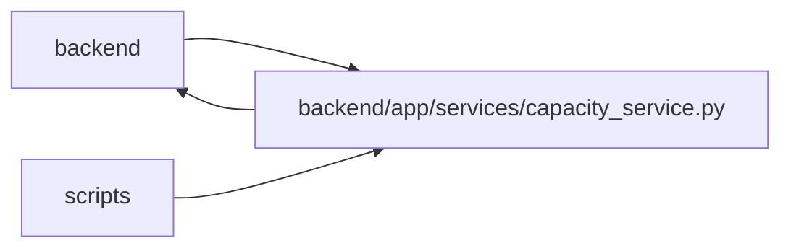

# capacity_service Module

**Path:** `backend/app/services/capacity_service.py`

## Description

Owns versioned person calendar and absence commands, date-based capacity projections, and commitment constraints. Managed edits require the linked human or an operator; trusted-local mode retains its explicit open boundary. Absence unions, calendar hours, allocation, utilization and coefficients are applied once. Private allocations contribute aggregate busy time only. Unknown effort and calendar coverage remain explicit; commitments require linked profiles, sufficient capacity and allocation date coverage.

Commitment projections select only required scalar task fields after complete scoped ancestry validation. Shared capacity conflicts remain aggregate constraints and never serialize private work or absence details.

Personal calendar choices apply to each relevant year across that person's allocations. With inherited rules, the service compares the allocations active on each local date. A missing year or incompatible overlapping policies keeps the available hours unknown. Changing an explicit annual selection checks the prior rules of the person's issued work, including the inherited rules that applied before their first personal selection.

An uncovered year in a saved commitment leaves its proportional daily effort uncertain, including when its allocation belongs to another project. The draft carries a warning for the visible capacity owner. Publishing a baseline requires that owner to reconcile the underlying annual rules.

## Imports

| Source | Symbols |
|--------|---------|
| `app.authority` | `AuthorityError`, `internal_authority` |
| `app.commands` | `PlanningConflict`, `atomic_command`, `lock_iterations`, `lock_planning` |
| `app.config` | `get_settings` |
| `app.models.calendar` | `Calendar` |
| `app.models.capacity` | `PlanningState`, `ProfileAbsence`, `ProfileAvailability` |
| `app.models.iteration` | `Iteration` |
| `app.models.task` | `Task`, `Task`, `Task` |
| `app.models.team_member` | `TeamMember`, `TeamMemberProfile`, `Vacation` |
| `app.services.calendar_rules` | `AnnualCalendars`, `YearRules`, `rule_signature`, `task_uses_years` |
| `app.services.calendar_service` | `CalendarService` |
| `app.services.execution_planning_window` | `live_assignments` |
| `app.services.snapshot_service` | `SnapshotService` |
| `app.services.task_service` | `TaskService` |
| `app.services.work_metrics` | `included_work_ids` |
| `collections` | `defaultdict` |
| `dataclasses` | `dataclass` |
| `datetime` | `date`, `timedelta` |
| `sqlalchemy` | `delete`, `select`, `update` |
| `sqlalchemy.orm` | `selectinload`, `selectinload`, `selectinload` |

## Local dependency map

<!-- Auto-generated local dependency summary. Do not edit by hand. -->

> Module-level dependencies exceed the generated-diagram limits, so the diagram and table below group them by top-level package. Counts report the number of module neighbors in each package.

### Internal neighbors

| Direction | Module |
|---|---|
| Inbound | `backend` (12) |
| Inbound | `scripts` (1) |
| Outbound | `backend` (14) |

### External packages

| Language | Used packages | Undeclared packages |
|---|---:|---:|
| python | 1 | 0 |

> All 27 module neighbor(s) are summarized by package because the module-level view exceeds the 12-node limit.

## Classes

| Class | Line | Bases | Description |
|-------|------|-------|-------------|
| [CommitmentRate](../entities/CommitmentRate.md) | 37 | — | — |
| [PeriodCommitments](../entities/PeriodCommitments.md) | 52 | — | Fold baseline rates at interval boundaries without expanding each task into daily rows. |
| [CapacityService](../entities/CapacityService.md) | 103 | — | — |

## Functions

| Function | Signature | Decorators | Description |
|----------|-----------|------------|-------------|
| `day_hours` | `(calendar, day)` | — | Return the hours of one matching record for existing single-date callers. |
| `agreed_calendar` | `(coverages, year)` | — | Resolve actual overlapping allocation rules, retaining ambiguity and missing coverage. |
