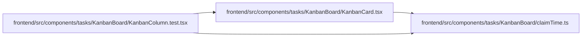

# claimTime Module

**Path:** `frontend/src/components/tasks/KanbanBoard/claimTime.ts`

## Description

/**
 * "18:42 GMT+3" for a claim that ends today, a short date and time otherwise: the reader's
 * local time, with its zone named so it reads unambiguously next to UTC times elsewhere.
 */

## Module Signals

| Signal | Values |
|--------|--------|
| Exports | `formatClaimUntil` |

## Local dependency map

<!-- Auto-generated local dependency summary. Do not edit by hand. -->

### Internal neighbors

| Direction | Module |
|---|---|
| Inbound | [KanbanCard](../modules/KanbanCard.md) |
| Inbound | [KanbanColumn.test](../modules/KanbanColumn.test.md) |

## Functions

| Function | Signature | Decorators | Description |
|----------|-----------|------------|-------------|
| `formatClaimUntil` | `(value: string, locale: string, now = new Date())` | — | "18:42 GMT+3" for a claim that ends today, a short date and time otherwise: the reader's |
