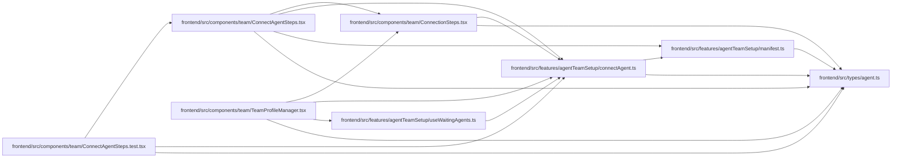

# connectAgent Module

**Path:** `frontend/src/features/agentTeamSetup/connectAgent.ts`

## Description

_Auto-generated from `frontend/src/features/agentTeamSetup/connectAgent.ts`._

## Imports

| Source | Symbols | Type-only | Runtime emission |
|--------|---------|-----------|------------------|
| `../../types/agent` | `AgentTeamMaster`, `AgentTeamMemberSpec`, `AgentTeamMemberStatus`, `AgentTeamRole`, `AgentTeamStatus` | Declaration | erased |
| `./manifest` | `assertAgentTeamMasterSecretFree` | — | compiler-dependent |
| `axios` | `axios` | — | compiler-dependent |

## Module Signals

| Signal | Values |
|--------|--------|
| Exports | `AGENT_RUNTIMES`, `AgentRuntime`, `CONNECT_STEPS`, `ConnectIssue`, `RUNTIME_PRODUCT_NAMES`, `STEP_INDEX`, `applyOutcomeUnknown`, `buildConnectedMember`, `connectIssue`, `credentialFilename`, `hasPM`, `isConnected`, `replacesPendingPM`, `runtimeOfMember`, `runtimeSnippet`, `waitingMembers` |
| Constants | `AGENT_RUNTIMES`, `RUNTIME_PRODUCT_NAMES`, `runtimeRecordNames`, `roleRecordNames`, `CONNECT_STEPS`, `STEP_INDEX` |

## Local dependency map

<!-- Auto-generated local dependency summary. Do not edit by hand. -->
This graph shows full source coupling. Type dependencies can be erased; compiler-dependent cycle groups are runtime candidates, not confirmed initialization cycles.

### Internal neighbors

| Direction | Module |
|---|---|
| Inbound | [ConnectAgentSteps.test](../modules/ConnectAgentSteps.test.md) |
| Inbound | [ConnectAgentSteps](../modules/ConnectAgentSteps.md) |
| Inbound | [ConnectionSteps](../modules/ConnectionSteps.md) |
| Inbound | [TeamProfileManager](../modules/TeamProfileManager.md) |
| Inbound | [useWaitingAgents](../modules/useWaitingAgents.md) |
| Outbound | [agentTeamSetup_manifest](../modules/agentTeamSetup_manifest.md) |
| Outbound | [types_agent](../modules/types_agent.md) |

### External packages

| Language | Used packages | Undeclared packages |
|---|---:|---:|
| typescript | 1 | 0 |

## Classes

| Class | Kind | Line | Bases / Target | Description |
|-------|------|------|----------------|-------------|
| [ConnectIssue](../entities/ConnectIssue.md) | Interface | 154 | — | — |
| [AgentRuntime](../entities/AgentRuntime.md) | Type alias | 6 | `(typeof AGENT_RUNTIMES)[number]` | — |
| [ConnectIssueReason](../entities/ConnectIssueReason.md) | Type alias | 152 | <pre><code>&#39;role&#39; &#124; &#39;runtime&#39; &#124; &#39;model&#39; &#124; &#39;sink&#39; &#124; &#39;teamChanged&#39; &#124; &#39;unavailable&#39; &#124; &#39;other&#39;&#10;    &#124; &#39;applyUnconfirmed&#39; &#124; &#39;deliveryUncertain&#39;</code></pre> | — |

## Functions

| Function | Signature | Decorators | Description |
|----------|-----------|------------|-------------|
| `buildConnectedMember` | `(points: { current: AgentTeamMaster \| null; template: AgentTeamMaster }, status: AgentTeamStatus, role: AgentTeamRole, runtime: AgentRuntime, model: string, previousAttempt?: string) -> { manifest: AgentTeamMaster; member: AgentTeamMemberSpec }` | — | Builds the manifest the server would hold after adding one member: the current |
| `credentialFilename` | *(async)* `(member: Pick<AgentTeamMemberSpec, 'credential_ref' \| 'actor_key'>) -> Promise<string>` | — | The name the server's filesystem credential sink gives this member's file: |
| `runtimeSnippet` | `(runtime: AgentRuntime, server: string, filename: string) -> string` | — | Shell setup for the runtime host: the key is read from the delivered file, never written here. |
| `connectIssue` | `(code: string, path = '') -> ConnectIssue` | — | Places a server code beside the answer that caused it, with a plain-language reason. |
| `applyOutcomeUnknown` | `(error: unknown) -> boolean` | — | Whether a failed apply request may still have been carried out. Without a server |
| `hasPM` | `(current: AgentTeamMaster \| null, status: AgentTeamStatus)` | — | The manifest allows one PM, so PM is offered only while the team has none. A PM |
| `replacesPendingPM` | `(current: AgentTeamMaster \| null, status: AgentTeamStatus)` | — | True when connecting a PM replaces a declared PM that was never configured. |
| `runtimeOfMember` | `(member: AgentTeamMemberSpec) -> AgentRuntime` | — | The runtime a member was connected on, read from the runtime reference the server keeps with it. |
| `isConnected` | `(memberStatus: AgentTeamMemberStatus \| undefined)` | — | Whether the server has seen this member's runtime acknowledge its package and reach the team. |
| `waitingMembers` | `(current: AgentTeamMaster \| null, status: AgentTeamStatus)` | — | Configured members that still wait for their runtime to acknowledge the package. They are read from the |
