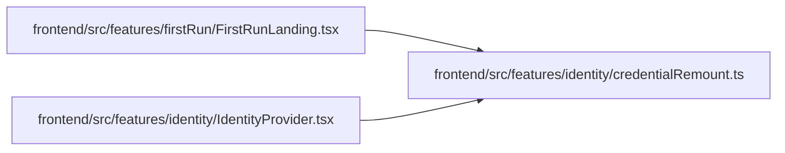

# credentialRemount Module

**Path:** `frontend/src/features/identity/credentialRemount.ts`

## Description

/**
 * Saving or clearing a key rebuilds the app under the identity provider. The next first-run guard
 * to mount is told the rebuild is not a fresh visit, so the page stays where it is.
 */

## Module Signals

| Signal | Values |
|--------|--------|
| Exports | `consumeCredentialRemount`, `markCredentialRemount` |

## Local dependency map

<!-- Auto-generated local dependency summary. Do not edit by hand. -->

### Internal neighbors

| Direction | Module |
|---|---|
| Inbound | [FirstRunLanding](../modules/FirstRunLanding.md) |
| Inbound | [IdentityProvider](../modules/IdentityProvider.md) |

## Functions

| Function | Signature | Decorators | Description |
|----------|-----------|------------|-------------|
| `markCredentialRemount` | `()` | — | — |
| `consumeCredentialRemount` | `()` | — | — |
