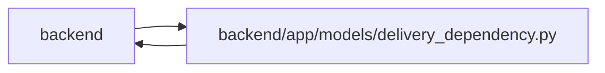

# delivery_dependency Module

**Path:** `backend/app/models/delivery_dependency.py`

## Description

Persists exactly one task or milestone prerequisite per delivery edge. Foreign-key restrictions protect referenced targets. Flush hooks collect relevant changes for the owning command’s global cycle validation and downstream invalidation; they do not independently commit.

## Imports

| Source | Symbols |
|--------|---------|
| `app.database` | `Base` |
| `app.models.project` | `ProjectMilestone` |
| `app.models.task` | `Task`, `TaskDependency` |
| `sqlalchemy` | `CheckConstraint`, `ForeignKey`, `Integer`, `String`, `UniqueConstraint`, `event`, `inspect` |
| `sqlalchemy.orm` | `Mapped`, `Session`, `mapped_column` |

## Local dependency map

<!-- Auto-generated local dependency summary. Do not edit by hand. -->

> Module-level dependencies exceed the generated-diagram limits, so the diagram and table below group them by top-level package. Counts report the number of module neighbors in each package.

### Internal neighbors

| Direction | Module |
|---|---|
| Inbound | `backend` (12) |
| Outbound | `backend` (3) |

### External packages

| Language | Used packages | Undeclared packages |
|---|---:|---:|
| python | 1 | 0 |

> All 15 module neighbor(s) are summarized by package because the module-level view exceeds the 12-node limit.

## Classes

| Class | Line | Bases | Description |
|-------|------|-------|-------------|
| [DeliveryDependency](../entities/DeliveryDependency.md) | 9 | `Base` | — |

## Functions

| Function | Signature | Decorators | Description |
|----------|-----------|------------|-------------|
| `track_delivery_changes` | `(session, _flush_context, _instances)` | `@event.listens_for(Session, 'before_flush')` | Collect changes for transactional downstream invalidation without rewriting history. |