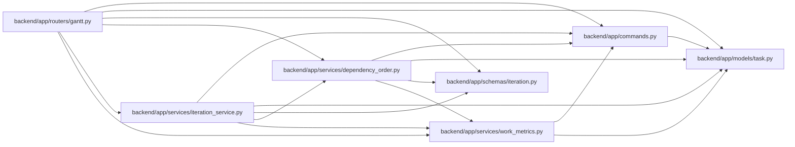

# dependency_order Module

**Path:** `backend/app/services/dependency_order.py`

## Description

Saved dependency order: dependents whose persisted dates start before their prerequisite ends.

The scheduler places a dependent on the day after its predecessor's end date
(``end_date`` is inclusive), so a saved start on or before that end date breaks
the order. Only planned leaf work is judged: started or finished work carries
actual dates, work that is deferred, canceled or inside a deferred branch is
backlog, and a prerequisite that is already resolved, closed or canceled no
longer constrains anything. Edges to work outside the iteration are ignored.

This module only reads. Correcting the dates is a schedule preview followed by
an explicit apply.

## Imports

| Source | Symbols |
|--------|---------|
| `__future__` | `annotations` |
| `app.commands` | `PlanningConflict` |
| `app.models.task` | `Task`, `TaskDependency`, `TaskStatus` |
| `app.schemas.iteration` | `InvertedDependency` |
| `app.services.work_metrics` | `included_work_ids` |
| `sqlalchemy` | `select` |
| `sqlalchemy.ext.asyncio` | `AsyncSession` |

## Local dependency map

<!-- Auto-generated local dependency summary. Do not edit by hand. -->

### Internal neighbors

| Direction | Module |
|---|---|
| Inbound | [routers_gantt](../modules/routers_gantt.md) |
| Inbound | [iteration_service](../modules/iteration_service.md) |
| Outbound | [commands](../modules/commands.md) |
| Outbound | [models_task](../modules/models_task.md) |
| Outbound | [schemas_iteration](../modules/schemas_iteration.md) |
| Outbound | [services_work_metrics](../modules/services_work_metrics.md) |

### External packages

| Language | Used packages | Undeclared packages |
|---|---:|---:|
| python | 1 | 0 |

## Functions

| Function | Signature | Decorators | Description |
|----------|-----------|------------|-------------|
| `inverted_saved_dependencies` | *(async)* `(db: AsyncSession, iteration_id: int) -> list[InvertedDependency]` | — | List the dependency pairs of one iteration whose saved dates are inverted. |
