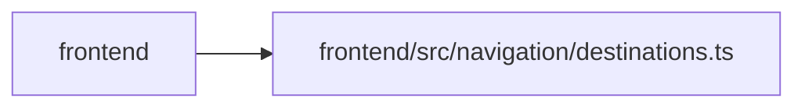

# destinations Module

**Path:** `frontend/src/navigation/destinations.ts`

## Description

_Auto-generated from `frontend/src/navigation/destinations.ts`._

## Imports

| Source | Symbols | Type-only | Runtime emission |
|--------|---------|-----------|------------------|
| `lucide-react` | `LucideIcon` | Declaration | erased |
| `lucide-react` | `BarChart`, `Bot`, `Calendar`, `Map`, `Network`, `Repeat`, `FolderOpen`, `GanttChartSquare`, `Inbox`, `LayoutDashboard`, `ListTodo`, `MapPin`, `Settings`, `UserCheck`, `Users` | — | compiler-dependent |
| `react-router-dom` | `matchPath` | — | compiler-dependent |

## Module Signals

| Signal | Values |
|--------|--------|
| Exports | `DESTINATIONS`, `DESTINATION_GROUPS`, `DESTINATION_VIEWS`, `Destination`, `DestinationCounterValues`, `DestinationId`, `destinationsOwningPath`, `formatDestinationCounter`, `getCounterSource`, `getDestination`, `getDestinationForPath` |
| Constants | `DESTINATION_GROUPS`, `DESTINATIONS`, `DESTINATION_VIEWS` |
| Module calls | `DESTINATIONS = flatMap` |

## Local dependency map

<!-- Auto-generated local dependency summary. Do not edit by hand. -->
This graph shows full source coupling. Type dependencies can be erased; compiler-dependent cycle groups are runtime candidates, not confirmed initialization cycles.

> Module-level dependencies exceed the generated-diagram limits, so the diagram and table below group them by top-level package. Counts report the number of module neighbors in each package.

### Internal neighbors

| Direction | Module |
|---|---|
| Inbound | `frontend` (13) |

### External packages

| Language | Used packages | Undeclared packages |
|---|---:|---:|
| typescript | 2 | 0 |

> All 13 module neighbor(s) are summarized by package because the module-level view exceeds the 12-node limit.

## Classes

| Class | Kind | Line | Bases / Target | Description |
|-------|------|------|----------------|-------------|
| [Destination](../entities/Destination.md) | Interface | 44 | — | — |
| [DestinationGroup](../entities/DestinationGroup.md) | Interface | 60 | — | — |
| [DestinationCounterValues](../entities/DestinationCounterValues.md) | Interface | 218 | — | — |
| [DestinationId](../entities/DestinationId.md) | Type alias | 22 | <pre><code>&#124; &#39;overview&#39;&#10;    &#124; &#39;my&#95;work&#39;&#10;    &#124; &#39;triage&#39;&#10;    &#124; &#39;projects&#39;&#10;    &#124; &#39;plan&#39;&#10;    &#124; &#39;gantt&#39;&#10;    &#124; &#39;tasks&#39;&#10;    &#124; &#39;analytics&#39;&#10;    &#124; &#39;team&#39;&#10;    &#124; &#39;settings&#39;</code></pre> | — |
| [DestinationGroupId](../entities/DestinationGroupId.md) | Type alias | 34 | `'start' \| 'plan' \| 'deliver' \| 'setup'` | — |
| [DestinationCounterSource](../entities/DestinationCounterSource.md) | Type alias | 42 | `'none' \| 'requestsWaiting' \| 'planProgress'` | Where a sidebar counter takes its number from. |

## Functions

| Function | Signature | Decorators | Description |
|----------|-----------|------------|-------------|
| `getDestination` | `(id: DestinationId) -> Destination` | — | — |
| `destinationsOwningPath` | `(pathname: string) -> Destination[]` | — | Every destination that claims the path; the registry is valid when this is never more than one. |
| `getDestinationForPath` | `(pathname: string) -> Destination \| undefined` | — | — |
| `getCounterSource` | `(destination: Destination) -> DestinationCounterSource` | — | — |
| `formatDestinationCounter` | `(destination: Destination, values: DestinationCounterValues) -> string \| null` | — | The counter text for a destination, or null when it shows none. |
