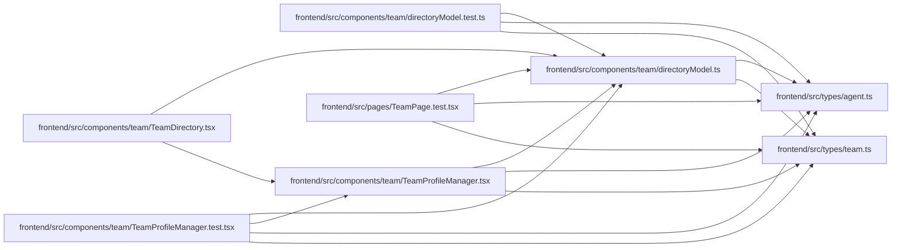

# directoryModel Module

**Path:** `frontend/src/components/team/directoryModel.ts`

## Description

_Auto-generated from `frontend/src/components/team/directoryModel.ts`._

## Imports

| Source | Symbols | Type-only | Runtime emission |
|--------|---------|-----------|------------------|
| `../../types/agent` | `AgentActorRosterItem`, `AgentModelBinding` | Declaration | erased |
| `../../types/team` | `TeamMemberProfile`, `TeamMemberProfileSkill` | Declaration | erased |

## Module Signals

| Signal | Values |
|--------|--------|
| Exports | `AgentStatus`, `CONNECTED_WINDOW_MS`, `ConnectionState`, `DirectoryActor`, `DirectoryKind`, `DirectoryRole`, `DirectoryRow`, `RosterState`, `actorName`, `agentStatus`, `buildDirectory`, `distinctRole`, `modelName`, `statusKnown` |
| Constants | `CONNECTED_WINDOW_MS`, `ROLE_ORDER`, `ACTOR_ROLES`, `MODE_ROLES`, `UNKNOWN_STATUS` |

## Local dependency map

<!-- Auto-generated local dependency summary. Do not edit by hand. -->
This graph shows full source coupling. Type dependencies can be erased; compiler-dependent cycle groups are runtime candidates, not confirmed initialization cycles.

### Internal neighbors

| Direction | Module |
|---|---|
| Inbound | [directoryModel.test](../modules/directoryModel.test.md) |
| Inbound | [TeamDirectory](../modules/TeamDirectory.md) |
| Inbound | [TeamProfileManager.test](../modules/TeamProfileManager.test.md) |
| Inbound | [TeamProfileManager](../modules/TeamProfileManager.md) |
| Inbound | [TeamPage.test](../modules/TeamPage.test.md) |
| Outbound | [types_agent](../modules/types_agent.md) |
| Outbound | [types_team](../modules/types_team.md) |

## Classes

| Class | Kind | Line | Bases / Target | Description |
|-------|------|------|----------------|-------------|
| [AgentStatus](../entities/AgentStatus.md) | Interface | 16 | — | What an agent's model and connection cells show. |
| [DirectoryActor](../entities/DirectoryActor.md) | Interface | 23 | — | One agent actor as read from the roster: a profile can have several, for example a Worker and a Reviewer. |
| [DirectoryRow](../entities/DirectoryRow.md) | Interface | 29 | — | — |
| [DirectoryKind](../entities/DirectoryKind.md) | Type alias | 4 | `'person' \| 'agent'` | — |
| [DirectoryRole](../entities/DirectoryRole.md) | Type alias | 5 | `'pm' \| 'worker' \| 'reviewer'` | — |
| [ConnectionState](../entities/ConnectionState.md) | Type alias | 7 | `'connected' \| 'not_connected' \| 'unknown'` | Connected and Not connected are read from the roster; Unknown means the roster could not be read. |
| [RosterState](../entities/RosterState.md) | Type alias | 13 | `'loaded' \| 'loading' \| 'unavailable'` | Loaded: the roster was read in this request. Loading: the first read is under way. Unavailable: no key, or the read failed. |

## Functions

| Function | Signature | Decorators | Description |
|----------|-----------|------------|-------------|
| `modelName` | `(binding: AgentModelBinding)` | — | — |
| `actorName` | `(actor: AgentActorRosterItem)` | — | — |
| `agentStatus` | `(actors: AgentActorRosterItem[], rosterState: RosterState, now: number) -> AgentStatus` | — | The only place a model or connection is read from roster data. It says Unknown whenever the roster |
| `statusKnown` | `(status: AgentStatus \| null) -> status is AgentStatus` | — | True when a status was read from the roster rather than left Unknown. |
| `distinctRole` | `(row: DirectoryRow, entry: DirectoryActor) -> DirectoryRole \| null` | — | The role that tells this actor apart within its row, or null when it has none or shares it with another actor. |
| `buildDirectory` | `(profiles: TeamMemberProfile[], roster: AgentActorRosterItem[], rosterState: RosterState, now: number = Date.now()) -> DirectoryRow[]` | — | One list of everyone who can do work. A profile is an agent when its kind says so or when an |
