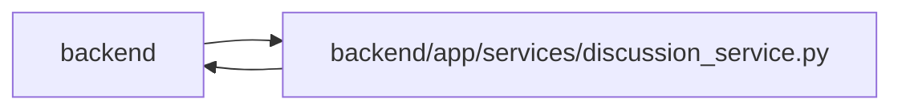

# discussion_service Module

**Path:** `backend/app/services/discussion_service.py`

## Description

Owns bounded human discussion, validated mentions, subscriptions and personal inbox projections. Comment edits use their own versions and retained revision history, without changing task execution evidence or planning revisions. Writes recheck task scope after locking. Worker intents are idempotent per event/recipient and dispatch rechecks live access and preferences; suppression terminates without claiming delivery. Inbox reads and read-state changes remain personal and task-scoped.

## Imports

| Source | Symbols |
|--------|---------|
| `app.authority` | `AuthorityError`, `internal_authority`, `require_project` |
| `app.commands` | `PlanningConflict`, `atomic_command` |
| `app.models.discussion` | `InboxNotification`, `TaskComment`, `TaskCommentRevision`, `TaskSubscription` |
| `app.models.identity` | `Principal`, `ProjectMembership`, `WorkspaceMembership` |
| `app.models.outbound_webhook` | `OutboundWebhookDelivery`, `OutboundWebhookEvent` |
| `app.models.task` | `Task` |
| `app.services.identity_service` | `IdentityService` |
| `app.services.outbound_webhook_service` | `OutboundDeliveryAttemptError` |
| `app.sql_semantics` | `portable_contains` |
| `app.utils.time` | `utc_now` |
| `hashlib` | `sha256` |
| `sqlalchemy` | `or_`, `select`, `update` |

## Local dependency map

<!-- Auto-generated local dependency summary. Do not edit by hand. -->

> Module-level dependencies exceed the generated-diagram limits, so the diagram and table below group them by top-level package. Counts report the number of module neighbors in each package.

### Internal neighbors

| Direction | Module |
|---|---|
| Inbound | `backend` (4) |
| Outbound | `backend` (10) |

### External packages

| Language | Used packages | Undeclared packages |
|---|---:|---:|
| python | 1 | 0 |

> All 12 module neighbor(s) are summarized by package because the module-level view exceeds the 12-node limit.

## Classes

| Class | Line | Bases | Description |
|-------|------|-------|-------------|
| [DiscussionService](../entities/DiscussionService.md) | 19 | — | — |