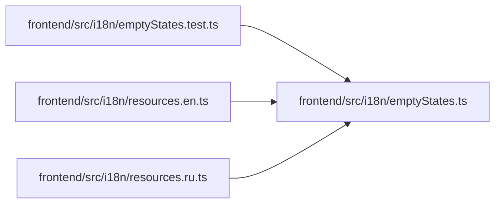

# emptyStates Module

**Path:** `frontend/src/i18n/emptyStates.ts`

## Description

/**
 * Copy for the empty states of each destination and view. Each state says what appears there in
 * one sentence; its one button comes from the first-run order (see useNextSetupAction).
 */

## Module Signals

| Signal | Values |
|--------|--------|
| Exports | `emptyStatesEnglish`, `emptyStatesRussian` |
| Constants | `emptyStatesEnglish`, `emptyStatesRussian` |

## Local dependency map

<!-- Auto-generated local dependency summary. Do not edit by hand. -->

### Internal neighbors

| Direction | Module |
|---|---|
| Inbound | [emptyStates.test](../modules/emptyStates.test.md) |
| Inbound | [resources.en](../modules/resources.en.md) |
| Inbound | [resources.ru](../modules/resources.ru.md) |
