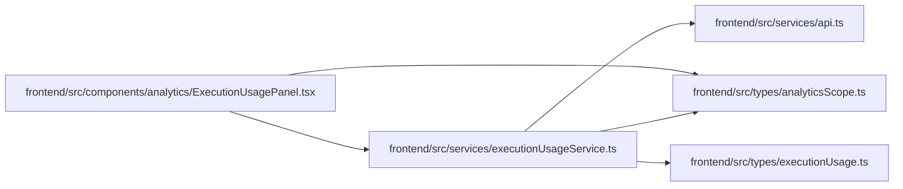

# executionUsageService Module

**Path:** `frontend/src/services/executionUsageService.ts`

## Description

_Auto-generated from `frontend/src/services/executionUsageService.ts`._

## Imports

| Source | Symbols | Type-only | Runtime emission |
|--------|---------|-----------|------------------|
| `../types/analyticsScope` | `AnalyticsScope` | Declaration | erased |
| `../types/executionUsage` | `ExecutionUsageSummary` | Declaration | erased |
| `./api` | `api` | — | compiler-dependent |

## Module Signals

| Signal | Values |
|--------|--------|
| Exports | `executionUsageService` |
| Constants | `executionUsageService` |

## Local dependency map

<!-- Auto-generated local dependency summary. Do not edit by hand. -->
This graph shows full source coupling. Type dependencies can be erased; compiler-dependent cycle groups are runtime candidates, not confirmed initialization cycles.

### Internal neighbors

| Direction | Module |
|---|---|
| Inbound | [ExecutionUsagePanel](../modules/ExecutionUsagePanel.md) |
| Outbound | [api](../modules/api.md) |
| Outbound | [analyticsScope](../modules/analyticsScope.md) |
| Outbound | [executionUsage](../modules/executionUsage.md) |
