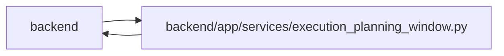

# execution_planning_window Module

**Path:** `backend/app/services/execution_planning_window.py`

## Description

Preserve a proved assignment context across an iteration end-date extension.

An iteration end-date extension still advances planning and task versions. Each eligible issued assignment keeps a digest of its original task, team and model context for that range of versions. A later scope, artifact, owner, authority or binding change makes the range unusable.

The planning-window and allocation commands share the durable live assignment and run states used by work control. Ownership checks retain queued and accepted assignments and running work when the underlying planning inputs change.

## Imports

| Source | Symbols |
|--------|---------|
| `__future__` | `annotations` |
| `app.agent_contract` | `EXECUTION_PLANNING_WINDOW_FEATURE`, `RUNTIME_INSTANCE_IDENTITY_FEATURE` |
| `app.authority` | `internal_authority` |
| `app.config` | `get_settings` |
| `app.models.agent` | `AgentActor`, `AgentIdempotencyRecord`, `AgentRun`, `AgentModelBinding`, `AgentModelCatalogEntry`, `AgentTaskAssignment`, `AgentTeamTopology`, `AgentTeamTopologyMember`, `TaskEvent` |
| `app.models.external_link` | `ExternalLink` |
| `app.models.identity` | `Principal`, `ProjectMembership`, `WorkspaceMembership` |
| `app.models.iteration` | `Iteration` |
| `app.models.project` | `Project` |
| `app.models.team_member` | `TeamMember` |
| `app.services.agent_service` | `AgentConflictError` |
| `app.services.agent_team_setup_service` | `_digest` |
| `app.services.execution_reconciliation` | `_json_value` |
| `app.services.review_provenance` | `actor_provenance`, `rework_binding_identity` |
| `app.utils.time` | `utc_now` |
| `hashlib` | `hashlib` |
| `itertools` | `itertools` |
| `json` | `json` |
| `sqlalchemy` | `select` |

## Local dependency map

<!-- Auto-generated local dependency summary. Do not edit by hand. -->

> Module-level dependencies exceed the generated-diagram limits, so the diagram and table below group them by top-level package. Counts report the number of module neighbors in each package.

### Internal neighbors

| Direction | Module |
|---|---|
| Inbound | `backend` (12) |
| Outbound | `backend` (14) |

### External packages

| Language | Used packages | Undeclared packages |
|---|---:|---:|
| python | 1 | 0 |

> All 25 module neighbor(s) are summarized by package because the module-level view exceeds the 12-node limit.

## Functions

| Function | Signature | Decorators | Description |
|----------|-----------|------------|-------------|
| `is_planning_only_change` | `(changed_fields) -> bool` | — | True when a non-empty set of changed task fields lies inside ``PLANNING_ONLY_FIELDS``. |
| `digest` | `(value)` | — | — |
| `task_context` | `(task)` | — | — |
| `execution_context` | `(task)` | — | The sealed task context without planning-only fields, plus labels and the optional flag. |
| `assignment_context` | `(assignment)` | — | — |
| `current_window` | `(task)` | — | — |
| `assignment_matches` | `(task, assignment)` | — | — |
| `candidate_version` | `(task)` | — | — |
| `earlier_acknowledgements` | *(async)* `(db, member)` | — | Return digests of the acknowledgement as it was before a runtime adopted newer fields. |
| `authority_stamp` | *(async)* `(db, task, assignment, *, lock = False, as_of = None)` | — | Fingerprint the actual scope, roster and bindings of both assignment principals. |
| `authority_matches` | *(async)* `(db, task, assignment, expected, *, lock = False)` | — | Compare a sealed stamp with current authority. |
| `_authority_basis` | *(async)* `(db, task, assignment, *, lock = False, as_of = None)` | — | — |
| `window_authority_matches` | *(async)* `(db, task, assignment, *, lock = False)` | — | — |
| `require_window_authority` | *(async)* `(db, task, assignment)` | — | — |
| `make_window` | `(task, old_version, assignments, *, prior = None, evidence, kind = ITERATION_END_EXTENSION)` | — | — |
| `original_ownership` | *(async)* `(db, task, row, before)` | — | Verify one current assignment against its original, authenticated worker, PM or reviewer receipt. |
| `seal_authority` | *(async)* `(db, task, window, assignments, *, prior = None, lock = False, as_of = None)` | — | — |
| `fence_planning_only_edit` | *(async)* `(db, basis, issued, *, edited_task_id, fields)` | — | Seal a window for each task whose version a planning-only edit reserved. |
| `extension_input` | *(async)* `(db, values, iterations)` | — | Only an explicit date-only extension may preserve issued execution state. |
| `live_assignments` | *(async)* `(db, task_ids, *, lock = False)` | — | — |
