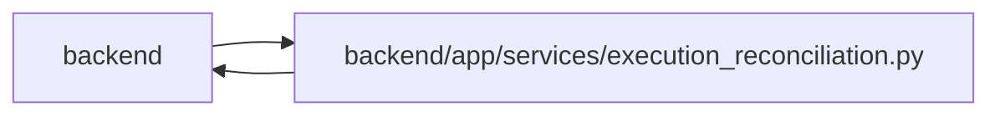

# execution_reconciliation Module

**Path:** `backend/app/services/execution_reconciliation.py`

## Description

Reconcile a terminal run using authenticated, contemporaneous server records.

An operator can preview which historical run facts are supported by contemporaneous server receipts. The preview identifies its evidence sources, missing fields and a digest. Applying that digest writes only compatible evidence and records the result in both the task timeline and the command audit, including when no field can be added.

## Imports

| Source | Symbols |
|--------|---------|
| `__future__` | `annotations` |
| `app.authority` | `AuthorityError`, `require_operator` |
| `app.commands` | `command_transaction` |
| `app.models.agent` | `AgentIdempotencyRecord`, `AgentRun`, `AgentTeamTopologyMember`, `TaskEvent` |
| `app.models.identity` | `CommandAudit` |
| `app.models.task` | `Task` |
| `app.query_limits` | `MAX_BOUNDED_LIST_ITEMS` |
| `app.schemas.agent_planning` | `AgentPlanningCommandContext` |
| `app.schemas.agent_team_setup` | `AgentTeamRuntimeAcknowledgement` |
| `app.services.agent_model_catalog_service` | `AgentModelConflictError` |
| `app.services.agent_routing_policy` | `ROUTING_DECISION_AUTHORITY` |
| `app.services.agent_service` | `actor_has_scope`, `is_admin_key_principal` |
| `app.services.agent_team_setup_service` | `_digest` |
| `app.services.review_provenance` | `recover_terminal_observation` |
| `app.utils.time` | `as_utc` |
| `contextlib` | `nullcontext` |
| `json` | `json` |
| `re` | `re` |
| `sqlalchemy` | `JSON`, `cast`, `func`, `select`, `update` |

## Local dependency map

<!-- Auto-generated local dependency summary. Do not edit by hand. -->

> Module-level dependencies exceed the generated-diagram limits, so the diagram and table below group them by top-level package. Counts report the number of module neighbors in each package.

### Internal neighbors

| Direction | Module |
|---|---|
| Inbound | `backend` (6) |
| Outbound | `backend` (14) |

### External packages

| Language | Used packages | Undeclared packages |
|---|---:|---:|
| python | 1 | 0 |

> All 20 module neighbor(s) are summarized by package because the module-level view exceeds the 12-node limit.

## Functions

| Function | Signature | Decorators | Description |
|----------|-----------|------------|-------------|
| `_object` | `(encoded)` | — | — |
| `_json_value` | `(db, column, *path, integer = False)` | — | Task event payloads are historical text on both supported databases. |
| `_ack_at_begin` | *(async)* `(db, run, supplied)` | — | — |
| `_latest_configuration` | *(async)* `(db, run, kind, target_id)` | — | An operator-only mutation without a full historic record fences off older evidence. |
| `_actor_binding_ids` | *(async)* `(db, run)` | — | — |
| `_model_at_begin` | *(async)* `(db, run, original, governed, ack)` | — | — |
| `_observations` | *(async)* `(db, run, archived_ack)` | — | — |
| `reconcile_execution` | *(async)* `(db, run_id, *, apply = False, archived_ack = None, expected_evidence_digest = None, command = None)` | — | — |
| `reconcile_execution_request` | *(async)* `(db, actor, run_id, *, apply = False, expected_evidence_digest = None, archived_acknowledgement = None, idempotency_key = None, rationale = None, correlation_id = None)` | — | — |