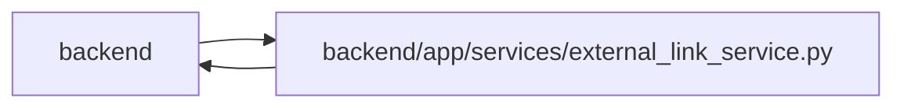

# external_link_service Module

**Path:** `backend/app/services/external_link_service.py`

## Description

External link service.

Manual GitHub links for tasks and releases use normalized repository coordinates and reject duplicates within their owning entity. A fenced worker begin or submit can record delivery links inside its existing version reservation. These links can later identify the submitted commit or pull request.

## Imports

| Source | Symbols |
|--------|---------|
| `app.authority` | `require_project` |
| `app.commands` | `commit_or_flush` |
| `app.models.external_link` | `ExternalLink`, `ExternalLinkEntityType` |
| `app.models.release` | `Release` |
| `app.models.task` | `Task` |
| `app.schemas.external_link` | `ExternalLinkCreate`, `ExternalLinkEntityType`, `ExternalLinkProvider`, `ExternalLinkResponse`, `ExternalLinkUpdate`, `TaskExternalLinkCreate`, `normalize_link_url` |
| `app.services.outbound_webhook_service` | `emit_outbound_webhook_event` |
| `app.services.task_context_revision_service` | `reserve_task_context_revision` |
| `app.utils.github_links` | `GitHubLinkError`, `ParsedGitHubLink`, `parse_github_url` |
| `sqlalchemy` | `delete`, `select` |
| `sqlalchemy.ext.asyncio` | `AsyncSession` |
| `typing` | `Optional`, `Sequence` |

## Local dependency map

<!-- Auto-generated local dependency summary. Do not edit by hand. -->

> Module-level dependencies exceed the generated-diagram limits, so the diagram and table below group them by top-level package. Counts report the number of module neighbors in each package.

### Internal neighbors

| Direction | Module |
|---|---|
| Inbound | `backend` (5) |
| Outbound | `backend` (9) |

### External packages

| Language | Used packages | Undeclared packages |
|---|---:|---:|
| python | 1 | 0 |

> All 14 module neighbor(s) are summarized by package because the module-level view exceeds the 12-node limit.

## Classes

| Class | Line | Bases | Description |
|-------|------|-------|-------------|
| [ExternalLinkValidationError](../entities/ExternalLinkValidationError.md) | 27 | `ValueError` | Raised when a provider-specific link cannot be parsed. |
| [ExternalLinkConflictError](../entities/ExternalLinkConflictError.md) | 31 | `Exception` | Raised when a provider-specific link already exists for an entity. |
| [ExternalLinkService](../entities/ExternalLinkService.md) | 35 | — | Service for generic external links and task-scoped link operations. |
