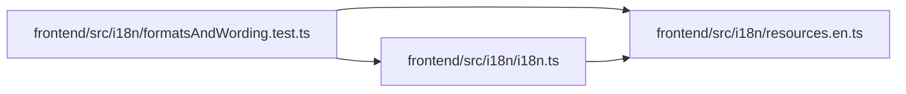

# formatsAndWording.test Module

**Path:** `frontend/src/i18n/formatsAndWording.test.ts`

## Description

_Auto-generated from `frontend/src/i18n/formatsAndWording.test.ts`._

## Imports

| Source | Symbols | Type-only | Runtime emission |
|--------|---------|-----------|------------------|
| `./i18n` | `i18n` | — | compiler-dependent |
| `./resources.en` | `englishResources` | — | compiler-dependent |
| `node:fs` | `readdirSync`, `readFileSync` | — | compiler-dependent |
| `node:path` | `join`, `resolve` | — | compiler-dependent |
| `vitest` | `describe`, `expect`, `it` | — | compiler-dependent |

## Module Signals

| Signal | Values |
|--------|--------|
| Constants | `english` |
| Module calls | `english = flatten`, `describe` |

## Local dependency map

<!-- Auto-generated local dependency summary. Do not edit by hand. -->

### Internal neighbors

| Direction | Module |
|---|---|
| Outbound | [i18n](../modules/i18n.md) |
| Outbound | [resources.en](../modules/resources.en.md) |

### External packages

| Language | Used packages | Undeclared packages |
|---|---:|---:|
| typescript | 1 | 0 |
