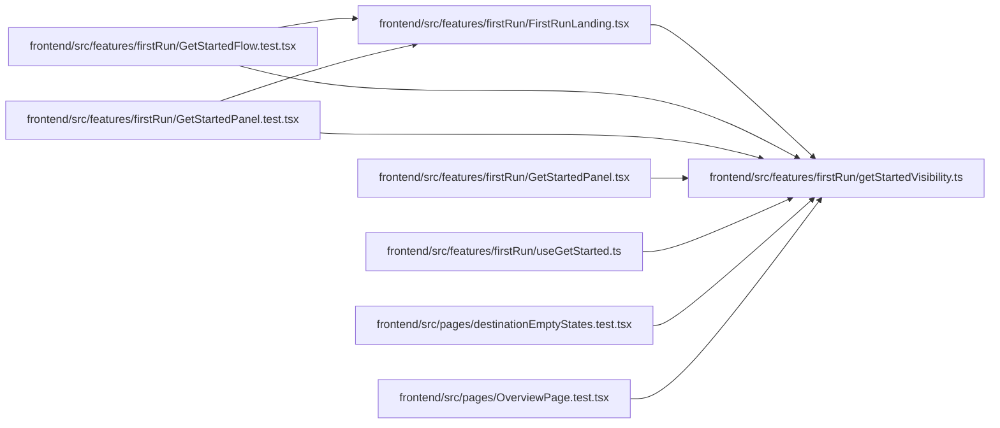

# getStartedVisibility Module

**Path:** `frontend/src/features/firstRun/getStartedVisibility.ts`

## Description

_Auto-generated from `frontend/src/features/firstRun/getStartedVisibility.ts`._

## Imports

| Source | Symbols | Type-only | Runtime emission |
|--------|---------|-----------|------------------|
| `zustand` | `create` | — | compiler-dependent |

## Module Signals

| Signal | Values |
|--------|--------|
| Exports | `GET_STARTED_DISMISSED_KEY`, `GetStartedRequest`, `readGetStartedDismissed`, `useGetStartedVisibility` |
| Constants | `GET_STARTED_DISMISSED_KEY`, `useGetStartedVisibility` |
| Module calls | `useGetStartedVisibility = create` |

## Local dependency map

<!-- Auto-generated local dependency summary. Do not edit by hand. -->

### Internal neighbors

| Direction | Module |
|---|---|
| Inbound | [FirstRunLanding](../modules/FirstRunLanding.md) |
| Inbound | [GetStartedFlow.test](../modules/GetStartedFlow.test.md) |
| Inbound | [GetStartedPanel.test](../modules/GetStartedPanel.test.md) |
| Inbound | [GetStartedPanel](../modules/GetStartedPanel.md) |
| Inbound | [useGetStarted](../modules/useGetStarted.md) |
| Inbound | [destinationEmptyStates.test](../modules/destinationEmptyStates.test.md) |
| Inbound | [OverviewPage.test](../modules/OverviewPage.test.md) |

### External packages

| Language | Used packages | Undeclared packages |
|---|---:|---:|
| typescript | 1 | 0 |

## Classes

| Class | Kind | Line | Bases / Target | Description |
|-------|------|------|----------------|-------------|
| [GetStartedVisibility](../entities/GetStartedVisibility.md) | Interface | 39 | — | — |
| [GetStartedRequest](../entities/GetStartedRequest.md) | Type alias | 37 | `false \| 'pending' \| 'incomplete' \| 'complete'` | Reopened from Help. `pending` until the steps are known; `incomplete` lasts until setup is |

## Functions

| Function | Signature | Decorators | Description |
|----------|-----------|------------|-------------|
| `readGetStartedDismissed` | `() -> boolean` | — | — |
