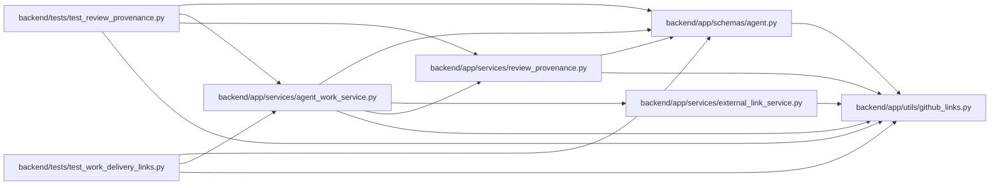

# github_links Module

**Path:** `backend/app/utils/github_links.py`

## Description

Parse GitHub URLs that trace delivery work: pull requests, issues, branches, commits and tags.

## Imports

| Source | Symbols |
|--------|---------|
| `__future__` | `annotations` |
| `dataclasses` | `dataclass` |
| `re` | `re` |
| `typing` | `Any`, `Optional` |
| `urllib.parse` | `urlparse` |

## Local dependency map

<!-- Auto-generated local dependency summary. Do not edit by hand. -->

### Internal neighbors

| Direction | Module |
|---|---|
| Inbound | [schemas_agent](../modules/schemas_agent.md) |
| Inbound | [agent_work_service](../modules/agent_work_service.md) |
| Inbound | [external_link_service](../modules/external_link_service.md) |
| Inbound | [review_provenance](../modules/review_provenance.md) |
| Inbound | [test_review_provenance](../modules/test_review_provenance.md) |
| Inbound | [test_work_delivery_links](../modules/test_work_delivery_links.md) |

## Classes

| Class | Line | Bases | Description |
|-------|------|-------|-------------|
| [GitHubLinkError](../entities/GitHubLinkError.md) | 17 | `ValueError` | Raised when a URL is not a supported GitHub link. |
| [ParsedGitHubLink](../entities/ParsedGitHubLink.md) | 22 | — | Normalized GitHub link details ready for persistence. |

## Functions

| Function | Signature | Decorators | Description |
|----------|-----------|------------|-------------|
| `_commit` | `(owner: str, repo: str, raw_sha: str) -> ParsedGitHubLink` | — | — |
| `parse_github_url` | `(raw_url: str) -> ParsedGitHubLink` | — | Parse a GitHub pull request, issue, branch, commit, or release tag URL. |
| `require_github_link` | `(raw_url: str, github_type: str) -> str` | — | Return the normalized URL when it is a GitHub link of the given type. |
