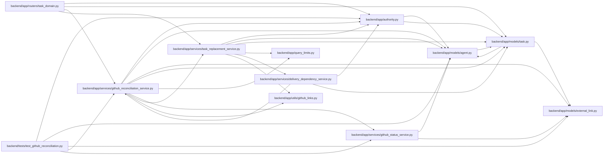

# github_reconciliation_service Module

**Path:** `backend/app/services/github_reconciliation_service.py`

## Description

Reconcile what a task submitted with what GitHub currently shows for its pull requests.

The read model compares the commit each run submitted with the observed head,
checks, merge or unmerged closure, and the review state, and names who acts
next. Catch-up refreshes the task's own pull request links from GitHub for
events a deployment never received. Observing a merge never accepts or closes a
task: acceptance stays with the independent reviewer's verdict.

## Imports

| Source | Symbols |
|--------|---------|
| `app.authority` | `require_project` |
| `app.models.agent` | `AgentRun`, `AgentTaskAssignment` |
| `app.models.external_link` | `ExternalLink`, `ExternalLinkEntityType` |
| `app.models.task` | `Task` |
| `app.query_limits` | `MAX_BOUNDED_LIST_ITEMS` |
| `app.services.github_status_service` | `GitHubStatusService`, `parse_github_time` |
| `app.services.task_replacement_service` | `relation_for` |
| `app.utils.github_links` | `GitHubLinkError`, `parse_github_url` |
| `sqlalchemy` | `select` |
| `typing` | `Any`, `Optional` |

## Local dependency map

<!-- Auto-generated local dependency summary. Do not edit by hand. -->

### Internal neighbors

| Direction | Module |
|---|---|
| Inbound | [routers_task_domain](../modules/routers_task_domain.md) |
| Inbound | [delivery_dependency_service](../modules/delivery_dependency_service.md) |
| Inbound | [test_github_reconciliation](../modules/test_github_reconciliation.md) |
| Outbound | [authority](../modules/authority.md) |
| Outbound | [models_agent](../modules/models_agent.md) |
| Outbound | [models_external_link](../modules/models_external_link.md) |
| Outbound | [models_task](../modules/models_task.md) |
| Outbound | [query_limits](../modules/query_limits.md) |
| Outbound | [github_status_service](../modules/github_status_service.md) |
| Outbound | [task_replacement_service](../modules/task_replacement_service.md) |
| Outbound | [github_links](../modules/github_links.md) |

### External packages

| Language | Used packages | Undeclared packages |
|---|---:|---:|
| python | 1 | 0 |

## Classes

| Class | Line | Bases | Description |
|-------|------|-------|-------------|
| [GitHubReconciliationService](../entities/GitHubReconciliationService.md) | 49 | — | Read and catch up the GitHub reconciliation of one task. |

## Functions

| Function | Signature | Decorators | Description |
|----------|-----------|------------|-------------|
| `_sha` | `(url: Optional[str]) -> Optional[str]` | — | — |
| `_pull_key` | `(url: Optional[str]) -> Optional[str]` | — | — |
| `pull_state` | `(link: ExternalLink) -> str` | — | open, draft, merged, closed_unmerged, or unobserved. |
