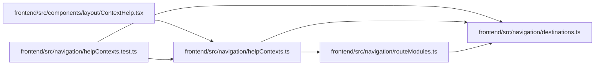

# helpContexts Module

**Path:** `frontend/src/navigation/helpContexts.ts`

## Description

_Auto-generated from `frontend/src/navigation/helpContexts.ts`._

## Imports

| Source | Symbols | Type-only | Runtime emission |
|--------|---------|-----------|------------------|
| `./destinations` | `DestinationId` | Specifier | compiler-dependent |
| `./destinations` | `getDestination`, `getDestinationForPath` | — | compiler-dependent |
| `./routeModules` | `RouteModuleKey` | Specifier | compiler-dependent |
| `./routeModules` | `metadataForPath` | — | compiler-dependent |

## Module Signals

| Signal | Values |
|--------|--------|
| Exports | `WorkflowGuideKey`, `getHelpContext` |
| Constants | `DESTINATION_HELP`, `WORKFLOW_BY_ROUTE`, `SETUP_GUIDE_ENTRY` |

## Local dependency map

<!-- Auto-generated local dependency summary. Do not edit by hand. -->
This graph shows full source coupling. Type dependencies can be erased; compiler-dependent cycle groups are runtime candidates, not confirmed initialization cycles.

### Internal neighbors

| Direction | Module |
|---|---|
| Inbound | [ContextHelp](../modules/ContextHelp.md) |
| Inbound | [helpContexts.test](../modules/helpContexts.test.md) |
| Outbound | [destinations](../modules/destinations.md) |
| Outbound | [routeModules](../modules/routeModules.md) |

## Classes

| Class | Kind | Line | Bases / Target | Description |
|-------|------|------|----------------|-------------|
| [GlossaryTerm](../entities/GlossaryTerm.md) | Type alias | 13 | <pre><code>&#39;iteration&#39; &#124; &#39;capacity&#39; &#124; &#39;blockers&#39; &#124; &#39;assignee&#39; &#124; &#39;reviewer&#39; &#124; &#39;labels&#39;&#10;    &#124; &#39;waits&#95;for&#39; &#124; &#39;earliest&#95;start&#39; &#124; &#39;due&#95;by&#39; &#124; &#39;request&#39; &#124; &#39;notifications&#39;</code></pre> | — |
| [WorkflowGuideKey](../entities/WorkflowGuideKey.md) | Type alias | 16 | `'plan' \| 'gantt' \| 'tasks' \| 'settings'` | — |
| [HelpRelatedLink](../entities/HelpRelatedLink.md) | Type alias | 18 | <pre><code>&#123;&#10;    to&#58; string&#59;&#10;    labelKey&#58; string&#59;&#10;    defaultLabel&#58; string&#59;&#10;&#125;</code></pre> | — |
| [DestinationHelp](../entities/DestinationHelp.md) | Type alias | 24 | <pre><code>&#123;&#10;    &#47;&#42;&#42; The text is &#96;contextHelp&#46;destinations&#46;&#60;id&#62;&#46;summary&#96; in both catalogs&#46; &#42;&#47;&#10;    glossary&#58; readonly GlossaryTerm&#91;&#93;&#59;&#10;    related&#58; readonly DestinationId&#91;&#93;&#59;&#10;&#125;</code></pre> | — |

## Functions

| Function | Signature | Decorators | Description |
|----------|-----------|------------|-------------|
| `getHelpContext` | `(pathname: string)` | — | — |
