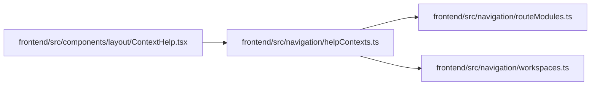

# helpContexts Module

**Path:** `frontend/src/navigation/helpContexts.ts`

## Description

_Auto-generated from `frontend/src/navigation/helpContexts.ts`._

## Imports

| Source | Symbols | Type-only | Runtime emission |
|--------|---------|-----------|------------------|
| `./routeModules` | `RouteModuleKey` | Specifier | compiler-dependent |
| `./routeModules` | `metadataForPath` | — | compiler-dependent |
| `./workspaces` | `getWorkspaceForPath`, `PRIMARY_NAV_ITEMS` | — | compiler-dependent |

## Module Signals

| Signal | Values |
|--------|--------|
| Exports | `HelpContentProvider`, `HelpRelatedLink`, `getHelpContext` |
| Constants | `CONTENT_PROVIDER_BY_ROUTE`, `RELATED_PATHS_BY_ROUTE`, `SPECIAL_RELATED_LINKS` |

## Local dependency map

<!-- Auto-generated local dependency summary. Do not edit by hand. -->
This graph shows full source coupling. Type dependencies can be erased; compiler-dependent cycle groups are runtime candidates, not confirmed initialization cycles.

### Internal neighbors

| Direction | Module |
|---|---|
| Inbound | [ContextHelp](../modules/ContextHelp.md) |
| Outbound | [routeModules](../modules/routeModules.md) |
| Outbound | [workspaces](../modules/workspaces.md) |

## Classes

| Class | Kind | Line | Bases / Target | Description |
|-------|------|------|----------------|-------------|
| [HelpContentProvider](../entities/HelpContentProvider.md) | Type alias | 10 | `'plan' \| 'gantt' \| 'tasks' \| 'settings' \| 'workspace'` | — |
| [HelpRelatedLink](../entities/HelpRelatedLink.md) | Type alias | 12 | <pre><code>&#123;&#10;    to&#58; string&#59;&#10;    labelKey&#58; string&#59;&#10;    defaultLabel&#58; string&#59;&#10;    descriptionKey&#63;&#58; string&#59;&#10;&#125;</code></pre> | — |

## Functions

| Function | Signature | Decorators | Description |
|----------|-----------|------------|-------------|
| `getHelpContext` | `(pathname: string)` | — | — |
