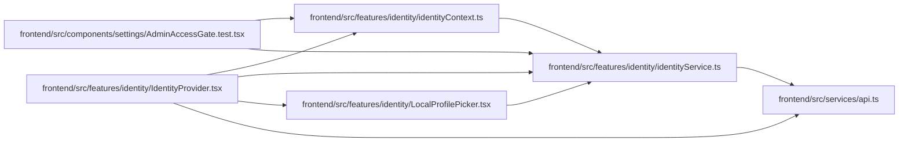

# identityService Module

**Path:** `frontend/src/features/identity/identityService.ts`

## Description

_Auto-generated from `frontend/src/features/identity/identityService.ts`._

## Imports

| Source | Symbols | Type-only | Runtime emission |
|--------|---------|-----------|------------------|
| `../../services/api` | `api` | — | compiler-dependent |

## Module Signals

| Signal | Values |
|--------|--------|
| Exports | `WorkProfile`, `WorkspaceIdentity`, `identityService` |
| Constants | `identityService` |

## Local dependency map

<!-- Auto-generated local dependency summary. Do not edit by hand. -->
This graph shows full source coupling. Type dependencies can be erased; compiler-dependent cycle groups are runtime candidates, not confirmed initialization cycles.

### Internal neighbors

| Direction | Module |
|---|---|
| Inbound | [AdminAccessGate.test](../modules/AdminAccessGate.test.md) |
| Inbound | [identityContext](../modules/identityContext.md) |
| Inbound | [IdentityProvider](../modules/IdentityProvider.md) |
| Inbound | [LocalProfilePicker](../modules/LocalProfilePicker.md) |
| Outbound | [api](../modules/api.md) |

## Classes

| Class | Kind | Line | Bases / Target | Description |
|-------|------|------|----------------|-------------|
| [WorkProfile](../entities/WorkProfile.md) | Interface | 4 | — | A linked profile is verified; a trusted-local session's own choice is not. |
| [WorkspaceIdentity](../entities/WorkspaceIdentity.md) | Interface | 6 | — | — |
