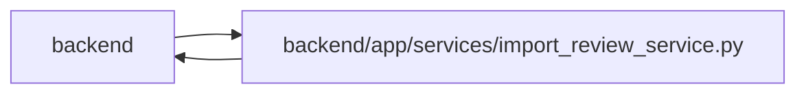

# import_review_service Module

**Path:** `backend/app/services/import_review_service.py`

## Description

Review a JSON plan import before it is applied, and apply only what was reviewed.

A dry run executes the real import writer inside a rollback-only command and
reports the difference between the target iteration before and after it, so
the proposal and the eventual write cannot drift apart. The review digest binds
three things: the canonical import file, the revisions of every iteration the
import reserves, and the exact change set. A write that carries the digest runs
the same writer, recomputes all three and is refused, and rolled back, unless
each one still matches.

## Imports

| Source | Symbols |
|--------|---------|
| `app.authority` | `Authority`, `internal_authority`, `require_project`, `AuthorityError` |
| `app.commands` | `AggregateVersionConflict`, `PlanningConflict`, `current_command` |
| `app.models.external_link` | `ExternalLink` |
| `app.models.identity` | `WorkspaceAuthorityState` |
| `app.models.iteration` | `Iteration` |
| `app.models.task` | `Task`, `TaskDependency`, `Task` |
| `app.models.team_member` | `TeamMember`, `Vacation`, `TeamMemberProfile`, `TeamMember`, `TeamMemberProfile` |
| `app.query_limits` | `MAX_ITERATION_TREE_TASKS` |
| `app.routers.export` | `MAX_JSON_IMPORT_BYTES`, `_validate_import_data`, `write_iteration_import`, `write_new_iteration_import`, `_optional_int` |
| `app.services.import_planning_service` | `import_file_sha256`, `import_scope_revisions`, `import_file_sha256`, `import_scope_revisions` |
| `app.services.iteration_service` | `IterationService` |
| `asyncio` | `asyncio` |
| `contextlib` | `contextmanager` |
| `dataclasses` | `replace` |
| `fastapi` | `HTTPException` |
| `hashlib` | `hashlib` |
| `json` | `json` |
| `re` | `re` |
| `sqlalchemy` | `event`, `func`, `select`, `text` |
| `sqlalchemy.exc` | `DBAPIError` |
| `typing` | `Any` |

## Local dependency map

<!-- Auto-generated local dependency summary. Do not edit by hand. -->

> Module-level dependencies exceed the generated-diagram limits, so the diagram and table below group them by top-level package. Counts report the number of module neighbors in each package.

### Internal neighbors

| Direction | Module |
|---|---|
| Inbound | `backend` (4) |
| Outbound | `backend` (11) |

### External packages

| Language | Used packages | Undeclared packages |
|---|---:|---:|
| python | 2 | 0 |

> All 14 module neighbor(s) are summarized by package because the module-level view exceeds the 12-node limit.

## Classes

| Class | Line | Bases | Description |
|-------|------|-------|-------------|
| [ImportFileInvalid](../entities/ImportFileInvalid.md) | 69 | `ValueError` | An import file field has the wrong type. |
| [ImportReviewRefused](../entities/ImportReviewRefused.md) | 76 | `PlanningConflict` | A reviewed import no longer matches what the reviewer saw. |

## Functions

| Function | Signature | Decorators | Description |
|----------|-----------|------------|-------------|
| `_canonical` | `(value) -> bytes` | — | — |
| `_sha256` | `(value) -> str` | — | — |
| `target_sha256` | `(iteration_id, revisions: dict) -> str` | — | Digest of the import target and the revision of every iteration it reserves. |
| `changes_sha256` | `(changes: dict) -> str` | — | — |
| `compose_review_digest` | `(file_sha: str, target_sha: str, change_sha: str) -> str` | — | — |
| `parse_review_digest` | `(value: str) -> tuple[str, str, str]` | — | — |
| `validate_import_payload` | `(data) -> None` | — | Apply the upload bounds of the import routes to a payload that did not arrive as a file. |
| `_iso` | `(value)` | — | — |
| `capture_import_state` | *(async)* `(db, iteration_id) -> dict[str, Any]` | — | Read every planning row an import can create or change in one iteration. |
| `_sort_key` | `(value) -> str` | — | — |
| `diff_import_state` | `(before, after, *, created_profiles: dict[int, dict]) -> dict[str, Any]` | — | Describe exactly what changed, naming rows the import creates by stable local references. |
| `summarize_changes` | `(changes: dict) -> dict[str, int]` | — | — |
| `_track_created_profiles` | `(db)` | `@contextmanager` | Collect the profiles this session inserts while the writer runs. |
| `run_import_with_changes` | *(async)* `(db, iteration_id, data, *, expected_revisions)` | — | Run the import writer and return its receipt with the exact change set it made. |
| `_referenced_project_ids` | `(iteration, data) -> set` | — | — |
| `_authorize_reviewer` | *(async)* `(db, iteration_id, data)` | — | The reviewer must be able to plan work in every project the import writes to. |
| `_file_tasks_with_depth` | `(data)` | — | — |
| `_file_tasks` | `(data)` | — | — |
| `_list_field` | `(row, name, where)` | — | — |
| `_bound_dry_run` | *(async)* `(db, iteration_id, data)` | — | Refuse a file too large to preview before any planning reservation is taken. |
| `_profile_reference` | `(value, where) -> int` | — | — |
| `_explicit_profile_ids` | `(data) -> set[int]` | — | — |
| `_resolved_profile_ids` | `(changes) -> set[int]` | — | Existing profiles the change set points at (created profiles carry string references). |
| `_team_profiles` | *(async)* `(db) -> set[int]` | — | Profiles of team members in iterations the caller can read, taken before the import runs. |
| `_require_readable_profiles` | *(async)* `(db, profile_ids, team_profiles: set[int])` | — | Under the caller's own authority: every profile the import refers to must be readable. |
| `_operator_simulation` | `(db, authority: Authority)` | `@contextmanager` | Run the writer as the operator who will apply it; the surrounding preview never commits. |
| `_operator_authority` | *(async)* `(db, caller: Authority \| None) -> Authority` | — | — |
| `_too_slow` | `() -> PlanningConflict` | — | — |
| `_run_within_budget` | *(async)* `(db, operator, iteration_id, data, revisions)` | — | Run the writer as the operator under a wall-clock budget; any overrun is refused and rolled back. |
| `dry_run_import` | *(async)* `(db, iteration_id, data) -> dict[str, Any]` | — | Return the exact changes an import of this file would make, and write nothing. |
| `apply_reviewed_import` | *(async)* `(db, iteration_id, data, review_digest: str)` | — | Apply an import only when it would make exactly the reviewed change set. |
