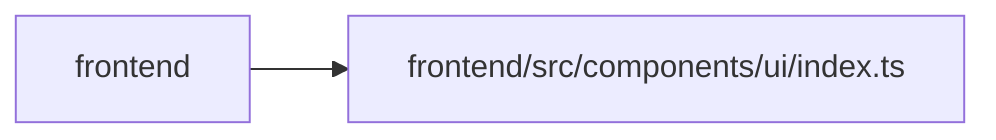

# index Module

**Path:** `frontend/src/components/ui/index.ts`

## Description

_Auto-generated from `frontend/src/components/ui/index.ts`._

## Module Signals

| Signal | Values |
|--------|--------|
| Exports | `FilterBar`, `FilterBarFilter`, `FilterBarOption`, `FormGrid`, `InlineEmptyState`, `InlineField`, `OverflowMenu`, `OverflowMenuItem`, `PageActions`, `PageHeader`, `PageLayout`, `PageToolbar`, `Pill`, `PillTone`, `STATUS_TONE`, `SectionCard`, `SegmentedControl`, `SegmentedOption`, `SlideOverDrawer`, `StatusSegment`, `StatusSegmentStrip`, `StickyRail`, `TableFrame`, `ViewSwitch`, `isTaskStatus`, `pillToneClassName`, `toneBorderClassName`, `toneDotClassName`, `toneGradientClassName`, `toneLineVar`, `toneSoftVar`, `toneSolidClassName`, `toneVar`, `wcPillClass` |

## Local dependency map

<!-- Auto-generated local dependency summary. Do not edit by hand. -->
This graph shows full source coupling. Type dependencies can be erased; compiler-dependent cycle groups are runtime candidates, not confirmed initialization cycles.

> Module-level dependencies exceed the generated-diagram limits, so the diagram and table below group them by top-level package. Counts report the number of module neighbors in each package.

### Internal neighbors

| Direction | Module |
|---|---|
| Inbound | `frontend` (42) |

> All 42 module neighbor(s) are summarized by package because the module-level view exceeds the 12-node limit.
