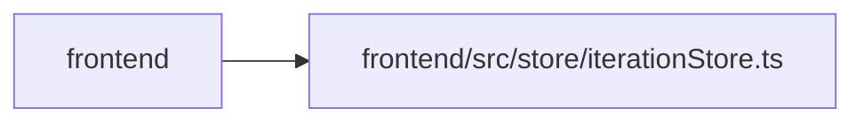

# iterationStore Module

**Path:** `frontend/src/store/iterationStore.ts`

## Description

_Auto-generated from `frontend/src/store/iterationStore.ts`._

## Imports

| Source | Symbols | Type-only | Runtime emission |
|--------|---------|-----------|------------------|
| `zustand` | `create` | — | compiler-dependent |
| `zustand/middleware` | `persist` | — | compiler-dependent |

## Module Signals

| Signal | Values |
|--------|--------|
| Exports | `pickDefaultIteration`, `useIterationStore` |
| Constants | `useIterationStore` |
| Module calls | `useIterationStore = create<IterationStore>()` |

## Local dependency map

<!-- Auto-generated local dependency summary. Do not edit by hand. -->

> Module-level dependencies exceed the generated-diagram limits, so the diagram and table below group them by top-level package. Counts report the number of module neighbors in each package.

### Internal neighbors

| Direction | Module |
|---|---|
| Inbound | `frontend` (15) |

### External packages

| Language | Used packages | Undeclared packages |
|---|---:|---:|
| typescript | 1 | 0 |

> All 15 module neighbor(s) are summarized by package because the module-level view exceeds the 12-node limit.

## Classes

| Class | Kind | Line | Bases / Target | Description |
|-------|------|------|----------------|-------------|
| [IterationStore](../entities/IterationStore.md) | Interface | 4 | — | — |
| [DatedIteration](../entities/DatedIteration.md) | Type alias | 21 | `{ id: number; start_date: string; end_date: string }` | — |

## Functions

| Function | Signature | Decorators | Description |
|----------|-----------|------------|-------------|
| `pickDefaultIteration` | `<T extends DatedIteration>(iterations: readonly T[], today: string = new Date().toISOString().slice(0, 10)) -> T \| undefined` | — | The one rule every page uses when no valid iteration is selected: the |
