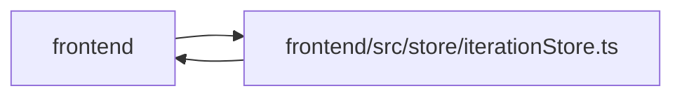

# iterationStore Module

**Path:** `frontend/src/store/iterationStore.ts`

## Description

_Auto-generated from `frontend/src/store/iterationStore.ts`._

## Imports

| Source | Symbols | Type-only | Runtime emission |
|--------|---------|-----------|------------------|
| `../features/scope/scopeStore` | `RememberedScope` | Specifier | compiler-dependent |
| `../features/scope/scopeStore` | `useScopeStore` | — | compiler-dependent |
| `../features/scope/workScope` | `ScopeIterationRecord` | Specifier | compiler-dependent |
| `../features/scope/workScope` | `resolveWorkScope` | — | compiler-dependent |
| `../navigation/scopeParams` | `parseScope` | — | compiler-dependent |
| `react` | `useMemo` | — | compiler-dependent |
| `react-router-dom` | `useLocation` | — | compiler-dependent |

## Module Signals

| Signal | Values |
|--------|--------|
| Exports | `useIterationStore` |
| Constants | `useIterationStore` |
| Module calls | `useIterationStore = assign` |

## Local dependency map

<!-- Auto-generated local dependency summary. Do not edit by hand. -->
This graph shows full source coupling. Type dependencies can be erased; compiler-dependent cycle groups are runtime candidates, not confirmed initialization cycles.

> Module-level dependencies exceed the generated-diagram limits, so the diagram and table below group them by top-level package. Counts report the number of module neighbors in each package.

### Internal neighbors

| Direction | Module |
|---|---|
| Inbound | `frontend` (11) |
| Outbound | `frontend` (3) |

### External packages

| Language | Used packages | Undeclared packages |
|---|---:|---:|
| typescript | 2 | 0 |

> All 14 module neighbor(s) are summarized by package because the module-level view exceeds the 12-node limit.

## Classes

| Class | Kind | Line | Bases / Target | Description |
|-------|------|------|----------------|-------------|
| [IterationStore](../entities/IterationStore.md) | Interface | 13 | — | The iteration-only view of the work scope, for pages that still set the iteration with |
