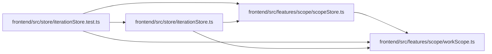

# iterationStore.test Module

**Path:** `frontend/src/store/iterationStore.test.ts`

## Description

_Auto-generated from `frontend/src/store/iterationStore.test.ts`._

## Imports

| Source | Symbols | Type-only | Runtime emission |
|--------|---------|-----------|------------------|
| `../features/scope/scopeStore` | `LEGACY_ITERATION_STORAGE_KEY`, `SCOPE_STORAGE_KEY`, `useScopeStore` | — | compiler-dependent |
| `../features/scope/workScope` | `pickDefaultIteration` | — | compiler-dependent |
| `./iterationStore` | `useIterationStore` | — | compiler-dependent |
| `@testing-library/react` | `renderHook` | — | compiler-dependent |
| `react` | `ReactNode` | Specifier | compiler-dependent |
| `react` | `createElement` | — | compiler-dependent |
| `react-router-dom` | `MemoryRouter` | — | compiler-dependent |
| `vitest` | `afterEach`, `beforeEach`, `describe`, `expect`, `it`, `vi` | — | compiler-dependent |
| Unresolved `dynamic-import` | — (line 154; deferred) | — | unclassified |

## Module Signals

| Signal | Values |
|--------|--------|
| Module calls | `describe`, `describe`, `describe` |

## Local dependency map

<!-- Auto-generated local dependency summary. Do not edit by hand. -->

### Internal neighbors

| Direction | Module |
|---|---|
| Outbound | [scopeStore](../modules/scopeStore.md) |
| Outbound | [workScope](../modules/workScope.md) |
| Outbound | [iterationStore](../modules/iterationStore.md) |

### External packages

| Language | Used packages | Undeclared packages |
|---|---:|---:|
| typescript | 4 | 0 |
