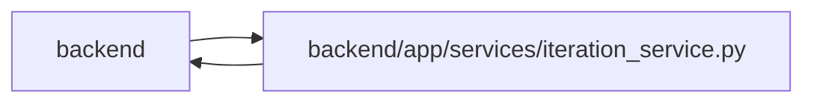

# iteration_service Module

**Path:** `backend/app/services/iteration_service.py`

## Description

Iteration metadata has an additive bounded ID-page contract with an initial upper bound. Existing newest-first small lists and date/ID pages remain compatible. Clients may restore display ordering after a finite authorized selector read.

Iteration service with business logic.

Calendar reassignment refreshes nominal workday and derived effort-day values under the existing planning transaction and version reservations. Canonical hours, unknown or zero estimates, estimate provenance and actual execution records are preserved.

Readiness and summary capacity use actual person calendar hours, short days, absence unions and allocation factors. Readiness includes shared booking and committed capacity conflicts without exposing private work details.
Its unassigned and missing-effort counts apply the same planned-leaf rule as the task filters, count agent-held tasks without a capacity row separately, and report how many capacity rows belong to agent profiles.
The planning-readiness summary also returns the six plan checkpoints (`iteration`, `team`, `work`, `blockers`, `schedule`, `review`) derived once by `plan_checkpoints`, so the plan page, the sidebar and the PM agent read the same states and the same "n of 6".

Iterations and series retain the primary calendar and their explicit additional calendar IDs. The period's working-day count and calendar checkpoint use every year in the interval, including any year between the two endpoints. A revision-bound annual selection can complete the calendar checkpoint while preserving the project target and the iteration dates.

## Imports

| Source | Symbols |
|--------|---------|
| `app.commands` | `atomic_command`, `commit_or_flush`, `lock_planning`, `schedule_input_command` |
| `app.models.agent` | `AgentTaskAssignment` |
| `app.models.calendar` | `Calendar` |
| `app.models.iteration` | `Iteration` |
| `app.models.project` | `Project`, `ProjectMilestone` |
| `app.models.task` | `Task`, `TaskStatus` |
| `app.models.team_member` | `TeamMember`, `TeamMember`, `TeamMemberProfile` |
| `app.query_limits` | `CollectionLimitExceededError`, `MAX_ITERATION_LIST_ITEMS`, `MAX_ITERATION_TREE_TASKS` |
| `app.schemas.iteration` | `IterationCreate`, `IterationPlanningReadinessSummary`, `IterationProjectSummary`, `IterationResponse`, `IterationSeriesCreate`, `IterationSummary`, `IterationUpdate` |
| `app.schemas.work_metrics` | `WorkMetricSummary` |
| `app.services.bounded_scope_reads` | `scope_page` |
| `app.services.calendar_rules` | `AnnualCalendars` |
| `app.services.calendar_service` | `CalendarService` |
| `app.services.capacity_service` | `CapacityService`, `CapacityService` |
| `app.services.dependency_order` | `inverted_saved_dependencies` |
| `app.services.plan_checkpoints` | `PLAN_CHECKPOINT_IDS`, `plan_checkpoints` |
| `app.services.planning_issues` | `LIVE_EXECUTION_ASSIGNMENT_STATES`, `PLANNING_ISSUE_STATUS` |
| `app.services.snapshot_service` | `SnapshotService` |
| `app.services.task_domain_service` | `nominal_day_hours`, `refresh_nominal_day_hours` |
| `app.services.task_postponement_service` | `require_unreferenced` |
| `app.services.task_service` | `TaskService` |
| `app.services.team_service` | `TeamService`, `TeamService` |
| `app.services.work_metrics` | `aggregate_metrics`, `working_today`, `included_work_ids`, `working_today` |
| `dataclasses` | `dataclass` |
| `datetime` | `date`, `timedelta` |
| `re` | `re` |
| `sqlalchemy` | `and_`, `case`, `exists`, `func`, `or_`, `select` |
| `sqlalchemy.ext.asyncio` | `AsyncSession` |
| `sqlalchemy.orm` | `aliased`, `selectinload` |
| `typing` | `Optional`, `Sequence` |

## Local dependency map

<!-- Auto-generated local dependency summary. Do not edit by hand. -->

> Module-level dependencies exceed the generated-diagram limits, so the diagram and table below group them by top-level package. Counts report the number of module neighbors in each package.

### Internal neighbors

| Direction | Module |
|---|---|
| Inbound | `backend` (27) |
| Outbound | `backend` (23) |

### External packages

| Language | Used packages | Undeclared packages |
|---|---:|---:|
| python | 1 | 0 |

> All 48 module neighbor(s) are summarized by package because the module-level view exceeds the 12-node limit.

## Classes

| Class | Line | Bases | Description |
|-------|------|-------|-------------|
| [IterationSeriesItem](../entities/IterationSeriesItem.md) | 39 | — | Computed iteration row for a series create request. |
| [IterationService](../entities/IterationService.md) | 46 | — | Service for iteration operations. |
