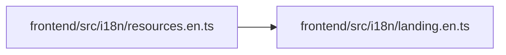

# landing.en Module

**Path:** `frontend/src/i18n/landing.en.ts`

## Description

_Auto-generated from `frontend/src/i18n/landing.en.ts`._

## Module Signals

| Signal | Values |
|--------|--------|
| Exports | `landingEnglish` |
| Constants | `landingEnglish` |

## Local dependency map

<!-- Auto-generated local dependency summary. Do not edit by hand. -->

### Internal neighbors

| Direction | Module |
|---|---|
| Inbound | [resources.en](../modules/resources.en.md) |
