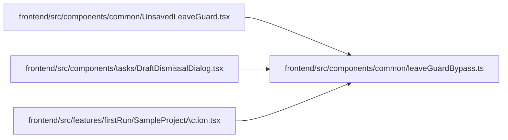

# leaveGuardBypass Module

**Path:** `frontend/src/components/common/leaveGuardBypass.ts`

## Description

_Auto-generated from `frontend/src/components/common/leaveGuardBypass.ts`._

## Module Signals

| Signal | Values |
|--------|--------|
| Exports | `leaveGuardsBypassed`, `navigateWithoutLeaveGuards` |

## Local dependency map

<!-- Auto-generated local dependency summary. Do not edit by hand. -->

### Internal neighbors

| Direction | Module |
|---|---|
| Inbound | [UnsavedLeaveGuard](../modules/UnsavedLeaveGuard.md) |
| Inbound | [DraftDismissalDialog](../modules/DraftDismissalDialog.md) |
| Inbound | [SampleProjectAction](../modules/SampleProjectAction.md) |

## Functions

| Function | Signature | Decorators | Description |
|----------|-----------|------------|-------------|
| `navigateWithoutLeaveGuards` | `(navigate: () => void)` | — | Runs a navigation that an app action starts itself, so unsaved-leave guards do not ask about it. |
| `leaveGuardsBypassed` | `()` | — | True while a navigation started by navigateWithoutLeaveGuards is being checked by the router. |
