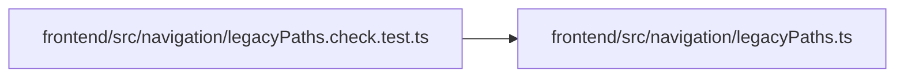

# legacyPaths.check.test Module

**Path:** `frontend/src/navigation/legacyPaths.check.test.ts`

## Description

_Auto-generated from `frontend/src/navigation/legacyPaths.check.test.ts`._

## Imports

| Source | Symbols | Type-only | Runtime emission |
|--------|---------|-----------|------------------|
| `./legacyPaths.ts` | `mapLegacyPath` | — | compiler-dependent |
| `node:assert` | `assert` | — | compiler-dependent |
| `node:test` | `describe`, `it` | — | compiler-dependent |

## Module Signals

| Signal | Values |
|--------|--------|
| Constants | `cases` |
| Module calls | `describe` |

## Local dependency map

<!-- Auto-generated local dependency summary. Do not edit by hand. -->

### Internal neighbors

| Direction | Module |
|---|---|
| Outbound | [legacyPaths](../modules/legacyPaths.md) |

## Classes

| Class | Kind | Line | Bases / Target | Description |
|-------|------|------|----------------|-------------|
| [Case](../entities/legacyPaths.check.test_Case.md) | Type alias | 11 | `readonly [pathname: string, search: string, expected: string \| null]` | — |
