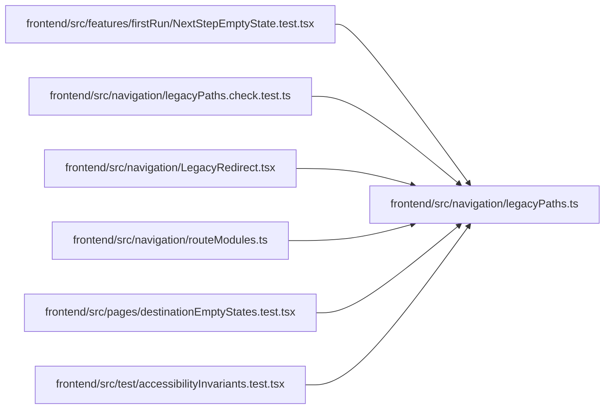

# legacyPaths Module

**Path:** `frontend/src/navigation/legacyPaths.ts`

## Description

A retired route maps to a current destination and a set of query defaults. Explicit query parameters supplied by the caller take precedence. Current paths are left in place, and an unrecognized legacy path is handled by normal route matching.

## Module Signals

| Signal | Values |
|--------|--------|
| Exports | `mapLegacyPath` |
| Constants | `LEGACY_RULES`, `CURRENT_PATHS` |
| Module calls | `CURRENT_PATHS = Set` |

## Local dependency map

<!-- Auto-generated local dependency summary. Do not edit by hand. -->

### Internal neighbors

| Direction | Module |
|---|---|
| Inbound | [NextStepEmptyState.test](../modules/NextStepEmptyState.test.md) |
| Inbound | [legacyPaths.check.test](../modules/legacyPaths.check.test.md) |
| Inbound | [LegacyRedirect](../modules/LegacyRedirect.md) |
| Inbound | [routeModules](../modules/routeModules.md) |
| Inbound | [destinationEmptyStates.test](../modules/destinationEmptyStates.test.md) |
| Inbound | [accessibilityInvariants.test](../modules/accessibilityInvariants.test.md) |

## Classes

| Class | Kind | Line | Bases / Target | Description |
|-------|------|------|----------------|-------------|
| [Rule](../entities/Rule.md) | Type alias | 3 | <pre><code>&#123;&#10;  from&#58; string&#59;&#10;  to&#58; string&#59;&#10;  params&#58; readonly &#40;readonly &#91;string&#44; string&#93;&#41;&#91;&#93;&#59;&#10;&#125;</code></pre> | — |

## Functions

| Function | Signature | Decorators | Description |
|----------|-----------|------------|-------------|
| `mapLegacyPath` | `(pathname: string, search: string) -> string \| null` | — | — |
