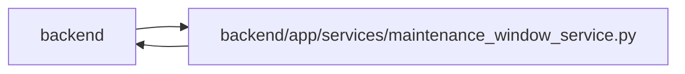

# maintenance_window_service Module

**Path:** `backend/app/services/maintenance_window_service.py`

## Description

Admit, begin, and close one coordinated control-plane maintenance window.

An announced window closes admission: no new work begins, claims, or starts a
run until the window is closed. Work already holding a live claim keeps
renewing and may finish. The operator can begin the window only when every
live claim's owner has acknowledged it for the claim's current generation, every
such lease outlives the bounded outage plus its margin, no running run lacks a
live claim, and every PM has a notice receipt. A long lease or a pause in a
worker's traffic is never an acknowledgement.

## Imports

| Source | Symbols |
|--------|---------|
| `__future__` | `annotations` |
| `app.authority` | `internal_authority` |
| `app.commands` | `commit_or_flush` |
| `app.models.agent` | `AgentActor`, `AgentRun` |
| `app.models.maintenance` | `MaintenanceWindow`, `MaintenanceWindowReceipt` |
| `app.models.task` | `Task` |
| `app.schemas.maintenance` | `MaintenanceOwnerAcknowledgement`, `MaintenanceWindowClose`, `MaintenanceWindowCreate`, `MaintenanceWindowNotice` |
| `app.services.agent_routing_service` | `AgentRoutingConflictError` |
| `app.utils` | `time` |
| `datetime` | `datetime`, `timedelta` |
| `secrets` | `secrets` |
| `sqlalchemy` | `select` |
| `sqlalchemy.exc` | `IntegrityError` |
| `sqlalchemy.ext.asyncio` | `AsyncSession` |
| `typing` | `Any` |

## Local dependency map

<!-- Auto-generated local dependency summary. Do not edit by hand. -->

> Module-level dependencies exceed the generated-diagram limits, so the diagram and table below group them by top-level package. Counts report the number of module neighbors in each package.

### Internal neighbors

| Direction | Module |
|---|---|
| Inbound | `backend` (4) |
| Outbound | `backend` (8) |

### External packages

| Language | Used packages | Undeclared packages |
|---|---:|---:|
| python | 1 | 0 |

> All 12 module neighbor(s) are summarized by package because the module-level view exceeds the 12-node limit.

## Classes

| Class | Line | Bases | Description |
|-------|------|-------|-------------|
| [MaintenanceWindowConflict](../entities/MaintenanceWindowConflict.md) | 41 | `AgentRoutingConflictError` | A stable, structured maintenance refusal shared by REST and MCP. |
| [MaintenanceWindowService](../entities/MaintenanceWindowService.md) | 125 | — | Operator and agent commands for one coordinated maintenance window. |

## Functions

| Function | Signature | Decorators | Description |
|----------|-----------|------------|-------------|
| `_iso` | `(value: datetime \| None) -> str \| None` | — | — |
| `_principal_id` | `(db: AsyncSession) -> int \| None` | — | — |
| `open_window` | *(async)* `(db: AsyncSession, *, lock: bool = False) -> MaintenanceWindow \| None` | — | — |
| `require_start_admission` | *(async)* `(db: AsyncSession) -> None` | — | Refuse a new start while a window is announced or in progress. |
| `window_view` | `(window: MaintenanceWindow) -> dict[str, Any]` | — | — |
| `receipt_view` | `(receipt: MaintenanceWindowReceipt) -> dict[str, Any]` | — | — |
| `_owner_key` | `(actor_id: int, task_id: int, generation: int) -> str` | — | — |
| `_pm_key` | `(actor_id: int) -> str` | — | — |
