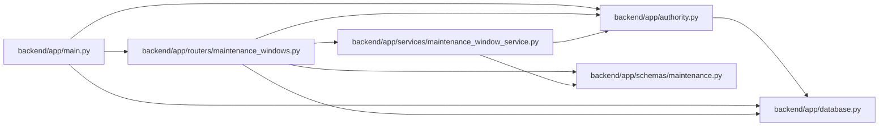

# maintenance_windows Module

**Path:** `backend/app/routers/maintenance_windows.py`

## Description

Operator commands for a coordinated control-plane maintenance window.

## Imports

| Source | Symbols |
|--------|---------|
| `app.authority` | `AuthorityError` |
| `app.database` | `get_db` |
| `app.schemas.maintenance` | `MaintenanceWindowCancel`, `MaintenanceWindowClose`, `MaintenanceWindowCreate`, `MaintenanceWindowNotice` |
| `app.services.maintenance_window_service` | `MaintenanceWindowConflict`, `MaintenanceWindowService` |
| `fastapi` | `APIRouter`, `Depends`, `HTTPException`, `Query`, `Request`, `status` |
| `sqlalchemy.ext.asyncio` | `AsyncSession` |
| `typing` | `Annotated`, `Any`, `NoReturn` |

## Local dependency map

<!-- Auto-generated local dependency summary. Do not edit by hand. -->

### Internal neighbors

| Direction | Module |
|---|---|
| Inbound | [app_main](../modules/app_main.md) |
| Outbound | [authority](../modules/authority.md) |
| Outbound | [app_database](../modules/app_database.md) |
| Outbound | [schemas_maintenance](../modules/schemas_maintenance.md) |
| Outbound | [maintenance_window_service](../modules/maintenance_window_service.md) |

### External packages

| Language | Used packages | Undeclared packages |
|---|---:|---:|
| python | 2 | 0 |

## Classes

| Class | Kind | Line | Bases / Target | Description |
|-------|------|------|----------------|-------------|
| [Service](../entities/Service.md) | Type alias | 34 | `Annotated[MaintenanceWindowService, Depends(get_maintenance_window_service)]` | — |

## Functions

| Function | Signature | Decorators | Description |
|----------|-----------|------------|-------------|
| `require_operator` | `(request: Request) -> None` | — | — |
| `get_maintenance_window_service` | *(async)* `(db: Annotated[AsyncSession, Depends(get_db, scope='function')]) -> MaintenanceWindowService` | — | — |
| `_refuse` | `(exc: Exception) -> NoReturn` | — | — |
| `list_maintenance_windows` | *(async)* `(service: Service, limit: int = Query(20, ge=1, le=100))` | `@router.get('/maintenance-windows', response_model=list[dict[str, Any]])` | Return recent windows, newest first, with their recorded actual times. |
| `announce_maintenance_window` | *(async)* `(data: MaintenanceWindowCreate, service: Service)` | `@router.post('/maintenance-windows', response_model=dict[str, Any], status_code=status.HTTP_201_CREATED)` | Announce a bounded window. Admission for new work closes immediately. |
| `get_maintenance_window` | *(async)* `(window_id: int, service: Service)` | `@router.get('/maintenance-windows/{window_id}', response_model=dict[str, Any])` | Return the window, its receipts, and what still blocks a safe begin. |
| `record_maintenance_notice` | *(async)* `(window_id: int, data: MaintenanceWindowNotice, service: Service)` | `@router.post('/maintenance-windows/{window_id}/notices', response_model=dict[str, Any])` | Record that a PM was notified through another channel. It never admits a live claim. |
| `begin_maintenance_window` | *(async)* `(window_id: int, service: Service)` | `@router.post('/maintenance-windows/{window_id}/begin', response_model=dict[str, Any])` | Begin the window and record the protected claims, or list every blocker. |
| `complete_maintenance_window` | *(async)* `(window_id: int, data: MaintenanceWindowClose, service: Service)` | `@router.post('/maintenance-windows/{window_id}/complete', response_model=dict[str, Any])` | Close a begun window, record its actual end and each protected claim's resumption. |
| `cancel_maintenance_window` | *(async)* `(window_id: int, data: MaintenanceWindowCancel, service: Service)` | `@router.post('/maintenance-windows/{window_id}/cancel', response_model=dict[str, Any])` | Withdraw an announced window before it begins and reopen admission. |
