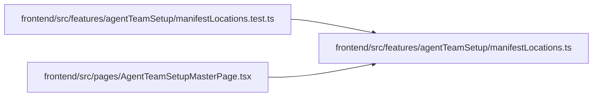

# manifestLocations Module

**Path:** `frontend/src/features/agentTeamSetup/manifestLocations.ts`

## Description

/**
 * Where things are in the manifest editor: the line of each JSON path, so a
 * problem can say "line 12" and the editor can jump there.
 */

## Module Signals

| Signal | Values |
|--------|--------|
| Exports | `EditorIssue`, `fieldIssues`, `lineForPath`, `lineRange`, `manifestPathLines`, `pathIssue`, `syntaxIssue` |

## Local dependency map

<!-- Auto-generated local dependency summary. Do not edit by hand. -->
This graph shows full source coupling. Type dependencies can be erased; compiler-dependent cycle groups are runtime candidates, not confirmed initialization cycles.

### Internal neighbors

| Direction | Module |
|---|---|
| Inbound | [manifestLocations.test](../modules/manifestLocations.test.md) |
| Inbound | [AgentTeamSetupMasterPage](../modules/AgentTeamSetupMasterPage.md) |

## Classes

| Class | Kind | Line | Bases / Target | Description |
|-------|------|------|----------------|-------------|
| [EditorIssue](../entities/EditorIssue.md) | Interface | 6 | — | Where things are in the manifest editor: the line of each JSON path, so a |

## Functions

| Function | Signature | Decorators | Description |
|----------|-----------|------------|-------------|
| `manifestPathLines` | `(text: string) -> Map<string, number>` | — | Paths such as `workers[0].role` mapped to the 1-based line where their key or value starts. |
| `lineForPath` | `(text: string, path: string) -> number \| null` | — | The line of a path, or of its nearest parent that exists in the text. |
| `syntaxIssue` | `(text: string, error: unknown) -> EditorIssue \| null` | — | A JSON syntax error with the line it happened on, when the browser reports a position. |
| `pathIssue` | `(text: string, message: string) -> EditorIssue` | — | The secret check names a JSON path such as `$.workers[0].token`. |
| `fieldIssues` | `(text: string, detail: unknown) -> EditorIssue[]` | — | FastAPI field errors: `loc` such as ["body", "manifest", "workers", 0, "role"]. |
| `lineRange` | `(text: string, line: number) -> [number, number]` | — | Character offsets of a 1-based line, to select it in a textarea. |
