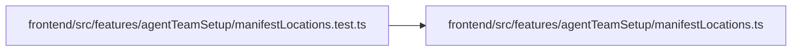

# manifestLocations.test Module

**Path:** `frontend/src/features/agentTeamSetup/manifestLocations.test.ts`

## Description

_Auto-generated from `frontend/src/features/agentTeamSetup/manifestLocations.test.ts`._

## Imports

| Source | Symbols | Type-only | Runtime emission |
|--------|---------|-----------|------------------|
| `./manifestLocations` | `fieldIssues`, `lineForPath`, `lineRange`, `manifestPathLines`, `pathIssue`, `syntaxIssue` | — | compiler-dependent |
| `vitest` | `describe`, `expect`, `it` | — | compiler-dependent |

## Module Signals

| Signal | Values |
|--------|--------|
| Constants | `text` |
| Module calls | `describe` |

## Local dependency map

<!-- Auto-generated local dependency summary. Do not edit by hand. -->

### Internal neighbors

| Direction | Module |
|---|---|
| Outbound | [manifestLocations](../modules/manifestLocations.md) |

### External packages

| Language | Used packages | Undeclared packages |
|---|---:|---:|
| typescript | 1 | 0 |
