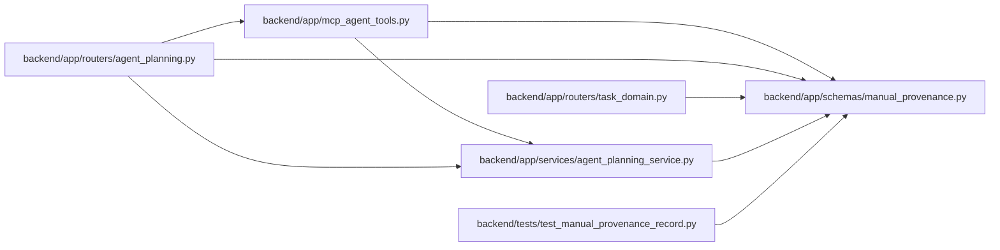

# manual_provenance Module

**Path:** `backend/app/schemas/manual_provenance.py`

## Description

Attributable execution provenance for resolved work that never ran through recorded runs.

## Imports

| Source | Symbols |
|--------|---------|
| `datetime` | `datetime` |
| `pydantic` | `BaseModel`, `ConfigDict`, `Field`, `field_validator`, `model_validator` |
| `typing` | `Literal` |

## Local dependency map

<!-- Auto-generated local dependency summary. Do not edit by hand. -->

### Internal neighbors

| Direction | Module |
|---|---|
| Inbound | [mcp_agent_tools](../modules/mcp_agent_tools.md) |
| Inbound | [routers_agent_planning](../modules/routers_agent_planning.md) |
| Inbound | [routers_task_domain](../modules/routers_task_domain.md) |
| Inbound | [agent_planning_service](../modules/agent_planning_service.md) |
| Inbound | [test_manual_provenance_record](../modules/test_manual_provenance_record.md) |

### External packages

| Language | Used packages | Undeclared packages |
|---|---:|---:|
| python | 1 | 0 |

## Classes

| Class | Line | Bases | Description |
|-------|------|-------|-------------|
| [ManualProvenanceExecutor](../entities/manual_provenance_ManualProvenanceExecutor.md) | 9 | `BaseModel` | The human or agent that actually executed the work. |
| [ManualProvenanceWrite](../entities/manual_provenance_ManualProvenanceWrite.md) | 29 | `BaseModel` | Record who executed one resolved task and the exact repository candidate they delivered. |
| [ManualProvenanceExecutorRecord](../entities/ManualProvenanceExecutorRecord.md) | 80 | `BaseModel` | — |
| [ManualProvenanceResponse](../entities/ManualProvenanceResponse.md) | 90 | `BaseModel` | The recorded provenance as it appears on the task timeline. |
