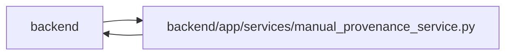

# manual_provenance_service Module

**Path:** `backend/app/services/manual_provenance_service.py`

## Description

Record who executed resolved work that was delivered outside recorded runs.

The record is an append-only task event. Every record counts its executor, and an
agent recorder, as contributors of the task for review independence, also after later
rework. Only the latest record at the task's current brief and artifact revisions
supplies the review candidate. Recording never reopens, resolves or accepts the task
and never touches its progress.

## Imports

| Source | Symbols |
|--------|---------|
| `app.authority` | `AuthorityError`, `internal_authority` |
| `app.commands` | `PlanningConflict`, `atomic_command` |
| `app.models.agent` | `AgentActor`, `AgentModelBinding`, `AgentModelCatalogEntry`, `AgentRun`, `AgentTaskAssignment`, `TaskEvent` |
| `app.models.external_link` | `ExternalLink` |
| `app.models.identity` | `Principal`, `PrincipalProfileLink`, `ProjectMembership` |
| `app.models.task` | `Task` |
| `app.models.team_member` | `TeamMemberProfile` |
| `app.query_limits` | `CollectionLimitExceededError` |
| `app.services.agent_routing_service` | `AgentRoutingService` |
| `app.services.github_status_service` | `GitHubStatusService` |
| `app.services.review_provenance` | `_submission_candidate`, `_submission_candidate`, `_manual_history`, `actor_provenance`, `actor_provenance` |
| `app.services.task_service` | `TaskService` |
| `app.utils.github_links` | `GitHubLinkError`, `parse_github_url` |
| `dataclasses` | `replace` |
| `httpx` | `httpx` |
| `json` | `json` |
| `sqlalchemy` | `func`, `select` |
| `sqlalchemy.orm` | `selectinload` |

## Local dependency map

<!-- Auto-generated local dependency summary. Do not edit by hand. -->

> Module-level dependencies exceed the generated-diagram limits, so the diagram and table below group them by top-level package. Counts report the number of module neighbors in each package.

### Internal neighbors

| Direction | Module |
|---|---|
| Inbound | `backend` (6) |
| Outbound | `backend` (13) |

### External packages

| Language | Used packages | Undeclared packages |
|---|---:|---:|
| python | 2 | 0 |

> All 18 module neighbor(s) are summarized by package because the module-level view exceeds the 12-node limit.

## Classes

| Class | Line | Bases | Description |
|-------|------|-------|-------------|
| [ProvenanceConflict](../entities/ProvenanceConflict.md) | 45 | `PlanningConflict` | A refusal that also names the offending fact, such as a commit and its attribution gap. |
| [ManualProvenanceService](../entities/ManualProvenanceService.md) | 200 | — | — |

## Functions

| Function | Signature | Decorators | Description |
|----------|-----------|------------|-------------|
| `remedy` | `(task_id)` | — | Where an accountable owner or PM records the missing provenance. |
| `require_provenance_recorder` | `(db, project_id)` | — | A signed-in owner, operator or project manager, or the project's PM agent, records provenance. |
| `_record_count` | *(async)* `(db, task_id)` | — | — |
| `provenance_blockers` | *(async)* `(db, task)` | — | Why a provenance record would be refused for this task now, as action blockers; empty when it may be recorded. |
| `_commit` | `(url, field)` | — | — |
| `_links` | `(data)` | — | — |
| `submitted_candidate` | `(record)` | — | The candidate fields review provenance verifies, as a worker submission would carry them. |
| `_valid` | `(record)` | — | — |
| `recorded_provenances` | *(async)* `(db, task)` | — | Every provenance record of the task, oldest first, and the one that applies to its current revisions. |
| `response` | `(event, record)` | — | — |
