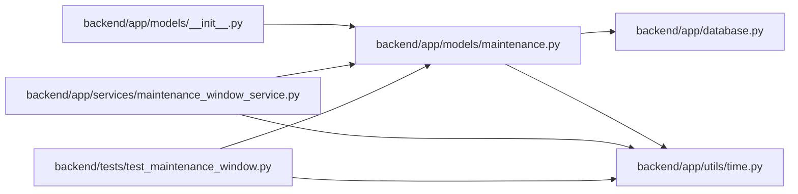

# maintenance Module

**Path:** `backend/app/models/maintenance.py`

## Description

Coordinated control-plane maintenance windows and their attributable receipts.

## Imports

| Source | Symbols |
|--------|---------|
| `app.database` | `Base` |
| `app.utils.time` | `UTCDateTime`, `utc_now` |
| `datetime` | `datetime` |
| `sqlalchemy` | `CheckConstraint`, `ForeignKey`, `Integer`, `JSON`, `String`, `Text`, `UniqueConstraint` |
| `sqlalchemy.orm` | `Mapped`, `mapped_column` |
| `typing` | `Any`, `Optional` |

## Local dependency map

<!-- Auto-generated local dependency summary. Do not edit by hand. -->

### Internal neighbors

| Direction | Module |
|---|---|
| Inbound | [models___init__](../modules/models___init__.md) |
| Inbound | [maintenance_window_service](../modules/maintenance_window_service.md) |
| Inbound | [test_maintenance_window](../modules/test_maintenance_window.md) |
| Outbound | [app_database](../modules/app_database.md) |
| Outbound | [time](../modules/time.md) |

### External packages

| Language | Used packages | Undeclared packages |
|---|---:|---:|
| python | 1 | 0 |

## Classes

| Class | Line | Bases | Description |
|-------|------|-------|-------------|
| [MaintenanceWindow](../entities/MaintenanceWindow.md) | 13 | `Base` | One bounded deployment window an operator announces, begins, and closes. |
| [MaintenanceWindowReceipt](../entities/MaintenanceWindowReceipt.md) | 64 | `Base` | A run owner's acknowledgement of a window or a PM's notice of it. |
